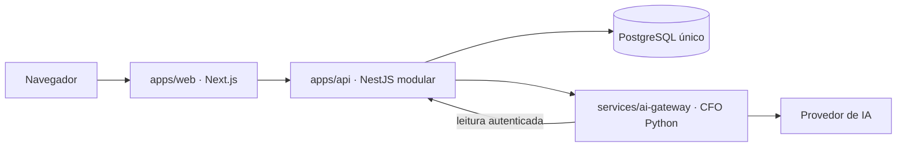

# Arquitetura atual do MVP

Estado do código em 2026-11-06, após a [limpeza autorizada](../transversal/2026-11-06-limpeza-monorepo-mvp.md).

O monorepo contém duas aplicações TypeScript e um serviço Python. A API é um
monólito modular: domínios compartilham processo e banco, com módulos e contratos
explícitos. Monorepo descreve onde o código vive; não exige distribuir cada domínio.

## Responsabilidades e dependências

- `apps/web/app/`: rotas, componentes e acesso à API pelo servidor.
- `apps/api/src/`: vendas, fluxo de caixa, financeiro, marketing, funcionários,
  identidade e arquivos. O motor de funcionários e a fila durável estão na API.
- `services/ai-gateway/`: CFO consultivo, autenticação interna, ferramentas de leitura
  e limites de tokens, passos e custo.
- `packages/contracts/`: TypeScript/JSON Schema/OpenAPI e geração. `contracts-py/`
  e `sdk/` participam da geração, portanto seus gerados não são descartáveis.
- `packages/config*` e `packages/observability*`: configuração e telemetria das
  duas linguagens, utilizadas pelo código e pelos testes.
- `infrastructure/docker/`: ambiente local, apoio aos testes e overlays existentes.
  PostgreSQL é único, com schemas por assunto. Redis e MinIO têm integrações/testes;
  sua retirada exigiria avaliar as funcionalidades correspondentes.

Aplicações compartilham código por `packages/`, nunca importando outra aplicação.
Pacotes não importam aplicações ou serviços consumidores. Contratos ficam na base
das dependências. TypeScript strict, dependency-cruiser e import-linter verificam
os limites; lint, contratos, testes e segurança permanecem.

## Execução

`npm run dev` inicia web/API. `make up` inicia os três processos após build;
`make health` verifica 3000, 3001 e 8002. O perfil Compose `runtime` contém os mesmos
três componentes. O gateway precisa de suas variáveis exportadas; esta limpeza
não altera o transporte de configuração. Confira os
[comandos e ambientes permitidos](../engenharia/comandos-validacao-ia.md).

## Limites da simplificação

Saíram `apps/tenant-provisioner`, `services/tenant-runtime`, `services/tool-gateway`
e `services/event-dispatcher`: só implementavam probes e telemetria. Também saíram
as pastas apenas reservadas de Terraform, Ansible e Kubernetes.

Contratos de runtime, PoCs, testes de segurança, migrations e históricos permanecem.
Não há declaração de isolamento multi-tenant implementado. Os ADRs 002/005/018/025
precisam de implementação/revisão antes de oferecer runtime dedicado por empresa.
Não substitua essas fronteiras por chamadas irrestritas dentro da API.

O [ADR-027](adr/0027-monorepo-enxuto-para-o-mvp-local.md) registra as alternativas e
propõe revisar a topologia futura. A IA não marcou essa proposta como aceita.
O pedido humano autorizou retirar scaffolding local; não liberou produção.
Novos serviços/pastas entram quando houver comportamento, fronteira de segurança
ou necessidade operacional concreta.
