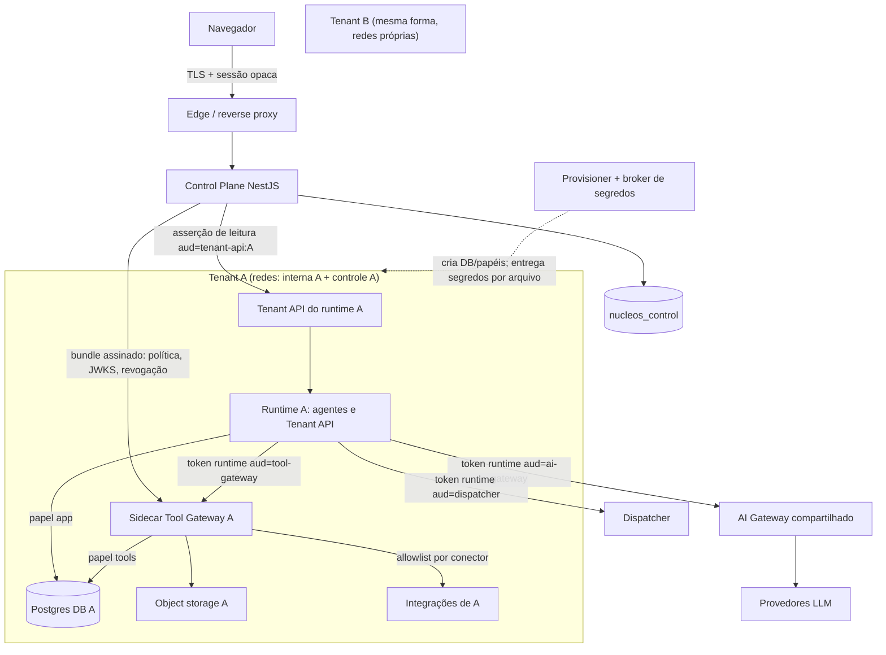

# ADR-025 — Acesso da UI aos dados do tenant e posição do Tool Gateway

- **Status:** Proposto (2026-10-26). O aceite é do usuário e fecha a questão Q-08 do [README do backlog](../../backlog/README.md). Nenhum item deste ADR está aceito por inferência.
- **Data:** 2026-10-26
- **Decisores:** a definir pelo usuário (proposta do executor DEC-013, Claude Sonnet 5.5)
- **Origem:** [ENT-DEC-013](../../backlog/EP-00-decisoes-pocs-e-threat-model/tickets.md#ent-dec-013); [ADR consolidado](../../transversal/2026-10-25-nucleos-enterprise-adr-arquitetura-mvp-e-evolucao.md) seções 4, 4.2, 6.1 (item 9), 8.2 e 14; [ADR-016](0016-autenticacao-de-usuarios-sessao-opaca-propria-vs-idp.md), [ADR-017](0017-acesso-a-dados-e-migrations-multi-database.md), [ADR-018](0018-identidade-de-servico-runtime-control-plane-gateways.md), [ADR-020](0020-gestao-de-segredos-do-mvp.md); [threat model](../../seguranca/2026-10-25-threat-model-stride-por-fronteira.md) (T-F6-*, T-F8-*, T-F11-*, RISK-013)

## Contexto

O consolidado afirma que o banco do Control Plane (CP) guarda só metadados mínimos (6.1.9) e que o Tool Gateway é a única via para banco, RAG, arquivos e integrações (8.2), mas não diz (1) como a UI lê dados privados do tenant (conversas, documentos, histórico de execuções) nem (2) onde o Tool Gateway roda e que credenciais de banco ele detém. O diagrama (seção 4) mostra "Tool Gateway: credenciais A" por tenant; a seção 14 o lista como serviço único. As duas leituras levam a modelos de ameaça muito diferentes: um gateway único com credenciais de todos os tenants é um alvo de alto valor. Do ADR-018 já vale: o runtime é parcialmente não confiável (executa código influenciado por LLM), token de usuário nunca entra no fluxo runtime-serviço, `tenant_id` do token nunca é prova, e a validação é local com `max_staleness` fail-closed.

## Problema

(1) Por qual caminho a UI lê dados privados do tenant sem ampliar o raio de ataque do CP e sem violar "metadados mínimos"? (2) Onde roda o Tool Gateway e quais credenciais cada componente detém, de modo que nenhum componente compartilhado possa abrir o banco de mais de um tenant (com as exceções declaradas na seção "Exceções ao critério")?

## Decisão

Adotar a **hipótese de partida do ticket: 1-A e 2-Y**, detalhada abaixo.

### Parte 1 — Leitura da UI: Control Plane como proxy de uma Tenant API interna (1-A)

1. O runtime de cada tenant expõe uma **Tenant API somente leitura** (porta própria, nunca publicada no host nem no edge), alcançável **apenas pelo CP**, por uma rede de controle por tenant (seção "Rede").
2. O navegador fala só com o CP (sessão opaca, ADR-016). O CP nunca encaminha o cookie/token de sessão ao runtime. Para cada leitura ele **emite uma asserção de leitura de usuário**: JWT EdDSA, `typ=nucleos-ui-read+jwt`, `iss=cp`, `sub=user:<user_id>`, **`aud=tenant-api:<tenant_id>`** (audiência única, como no ADR-018), `scope[]` (permissões já resolvidas pelo CP para aquela rota), `tenant_id`, `req` (id de correlação), `jti` de uso único, TTL ≤ 60 s. A unicidade de `jti` herda a premissa do ADR-018 (cache em memória por instância, uma única instância; reinício reabre a janela de até 60 s). O `tenant_id` vem da membership no banco central, nunca do corpo ou do cabeçalho do cliente.
3. A Tenant API valida localmente: algoritmo fixo EdDSA, `typ`, `kid` no JWKS, assinatura, `aud == "tenant-api:" + <tenant_id configurado no próprio runtime>` (**o tenant de referência é a configuração do runtime, não o claim**), janela com tolerância de 30 s, `jti` não visto, `scope` cobre a rota, e `max_staleness` do estado de revogação (ADR-018 7.1). Falha em qualquer item: 401/403 sem corpo detalhado e contagem em métrica.
4. A Tenant API consulta o banco com a credencial `app` do tenant (seção "Papéis PostgreSQL"), aplica autorização por recurso (por exemplo, a conversa pertence ao usuário ou ao departamento do `sub`) e devolve JSON com esquema fechado. O CP valida o esquema da resposta, impõe limite de tamanho e **não repassa cabeçalhos** do runtime.
5. **Conteúdo documental** (texto de documento, chunk, arquivo) não é lido pela credencial `app`: a Tenant API pede ao sidecar (parte 2) com uma **segunda asserção**, `aud=tool-gateway:<tenant_id>`, emitida pelo CP na mesma requisição e repassada pelo runtime. Assim cada token tem uma única audiência. A segunda asserção é **presa ao recurso**: leva `res` = `{type:"document", id}` (e `req`), emitida pelo CP somente para o recurso da rota que o usuário pediu, além do `scope` da rota; o sidecar rejeita se `res` diferir do argumento da chamada e consome o `jti` (uso único). Isto reduz o alcance de um runtime comprometido de "qualquer documento do ator" para "o documento que a UI pediu, uma vez, em até 60 s". A autorização por documento ("o ator pode ver este documento") ainda depende da origem da ACL descrita em P8' (risco residual R-1). Listagem de metadados de documento (id, título, estado) sai por uma view sem texto.
6. Isto **não** muda o ADR-018: o fluxo runtime→gateways continua com tokens `typ=nucleos-runtime+jwt`. As asserções acima são um tipo novo, no sentido CP→runtime/sidecar, que exige adendo ao ADR-018 (decisão H-3).

### Parte 2 — Tool Gateway como sidecar por tenant (2-Y)

7. O Tool Gateway roda como **um container por tenant** (mesma imagem versionada para todos os tenants, como o runtime), na rede interna do tenant, ao lado do runtime. Ele detém, **somente daquele tenant**: o papel PostgreSQL `tools`, as credenciais das integrações (OAuth/chaves) e a chave de acesso ao armazenamento de objetos. O runtime **não** tem nenhuma delas e não tem egress para integrações.
8. O runtime chama o sidecar com o token do ADR-018 (`aud=tool-gateway`, `sub=runtime:<tenant_id>`). O sidecar valida como qualquer gateway (ADR-018 §4), comparando `tenant_id` com o **seu próprio tenant configurado**. Cada invocação leva um contexto (`execution_id`, `agent_id`, `ator`) e é autorizada de novo no sidecar (ADR-012: deny-by-default, `allowed_tools` do agente, ação, recurso). Nas leituras de conteúdo pedidas pela UI, o sidecar exige ainda a segunda asserção (item 5): assinatura/`typ`/`aud` contra o seu tenant configurado, `res` igual ao argumento, `scope`, janela e `jti` de uso único. O LLM nunca decide autorização.
9. **Política e estado de revogação por bundle assinado, empurrado pelo CP.** O CP empurra ao sidecar (rede de controle) um bundle JSON assinado com Ed25519 contendo: `tenant_id`, `bundle_version` monotônica, `generated_at`, `valid_until`, políticas de ferramentas/agentes/conectores (sem segredos), JWKS vigente e o estado de revogação **somente daquele tenant** (`ver_minima`, `jti` revogados). **Raiz de confiança:** a chave pública de verificação do bundle (com `kid`) é entregue pelo provisioner como arquivo (ADR-020), fora do canal do bundle; sua rotação e revogação são procedimento do provisioner (nova chave entregue em arquivo, com sobreposição), nunca um bundle, porque o JWKS dos tokens vem do próprio bundle e uma chave de bundle vazada não pode ser removida pelo canal que ela assina. O sidecar verifica a assinatura, que `tenant_id` é o seu, `valid_until` (relógio de parede, tolerância de 30 s) e que a versão é maior que a vigente, e **persiste a `bundle_version` aceita** em disco do próprio tenant, para que um reinício não aceite um bundle antigo reenviado; mede a idade com relógio monotônico local; **após `max_staleness` (herdado do ADR-018, proposto 90 s) sem bundle novo, nega tudo** (`revocation_state_stale`). Push periódico (proposto: a cada 30 s) e imediato em emergência. Um snapshot velho entregue pelo CP disponível não é coberto (mesma lacuna do ADR-018 7.1); a opção (a) ou (b) de lá vale também aqui (H-4). A confiança vem da assinatura, não do canal; por isso o sidecar **não precisa de identidade própria no CP nem de egress para o CP**.
10. O sidecar grava a trilha `audit.tool_invocations` (append-only) com `execution_id`, ferramenta, ator, resultado, `jti`, `iss` e `kid` do token/asserção, sem argumentos sensíveis nem tokens.

### Papéis PostgreSQL por tenant (privilégios exatos)

Quatro papéis por tenant, nomes gerados por allowlist (ADR-017). Todos `NOSUPERUSER NOCREATEDB NOCREATEROLE NOREPLICATION NOBYPASSRLS NOINHERIT`. O database é revogado de `PUBLIC`; `CONNECT` só aos três papéis com login. Esquemas do tenant: `runtime` (operação do agente e da UI), `content` (documentos, chunks, embeddings) e `audit`.

| Papel | Login | Quem usa | Privilégios | Sem acesso |
| --- | --- | --- | --- | --- |
| `<t>_owner` | não | dono dos objetos | dono do database e dos esquemas; nunca usado em conexão direta | tudo fora do próprio tenant |
| `<t>_migrator` | sim, limite 2 | runner de migração (provisioner, ADR-017) | `SET ROLE <t>_owner` (membership `INHERIT FALSE, SET TRUE`); DDL só via owner; `GRANT` explícito de cada objeto novo nas migrations | runtime, sidecar e CP nunca o recebem |
| `<t>_app` | sim, limite 10 | runtime e Tenant API | `USAGE` em `runtime` e `audit`; `SELECT, INSERT, UPDATE` nas tabelas de `runtime` (sem `DELETE`); `SELECT` na view `runtime.documents_listing`; `SELECT` em `audit.tool_invocations` | `content` inteiro (sem `USAGE`), `INSERT/UPDATE/DELETE` em `audit`, DDL, `SET ROLE` |
| `<t>_tools` | sim, limite 10 | sidecar | `USAGE` em `content` e `audit`; `SELECT, INSERT, UPDATE, DELETE` nas tabelas de `content`; apenas `INSERT` (e `USAGE` da sequência) em `audit.tool_invocations` | `runtime` inteiro (sem `USAGE`), `SELECT/UPDATE/DELETE` em `audit` (append-only), DDL |

Fora desses papéis: o CP tem apenas o papel do banco `nucleos_control`; nenhum papel de tenant conecta a `nucleos_control`, a outro tenant, a `postgres` ou a `template1` (é preciso revogar `CONNECT` de `PUBLIC` também nestes dois, que vêm abertos por padrão; ver o bootstrap abaixo). A divisão em esquemas e as tabelas são **ilustrativas** do desenho; o inventário real é de DAT-001/DAT-002. Os privilégios dos **papéis de tenant** acima foram verificados em PostgreSQL 16.15 efêmero e a fase do provisioner sem superuser abaixo também (56 verificações, ver [PoC](../poc/dec-013/README.md)); limites do PoC: sem `pg_hba`, pgvector, RLS, carga nem Tenant API.

**Bootstrap da instância x operação do provisioner.** Duas fases, com credenciais diferentes. (1) *Bootstrap* (superuser, uma vez, manual ou na imagem do PostgreSQL): `REVOKE CONNECT ON DATABASE postgres, template1 FROM PUBLIC`, extensões (`vector`) e a criação do papel do provisioner. Sem superuser essa revogação **não tem efeito** (um não dono recebe erro ou `WARNING: no privileges could be revoked` e `datacl` não muda); como a revogação também retira o acesso do provisioner ao banco de manutenção, o bootstrap concede `CONNECT` em `postgres` a ele. (2) *Operação do provisioner* (`NOSUPERUSER CREATEDB CREATEROLE`): ao criar o tenant precisa de `SET` no owner (`GRANT <t>_owner TO prov WITH SET TRUE`, permitido ao criador do papel via `ADMIN`), senão `CREATE DATABASE ... OWNER` falha com `must be able to SET ROLE`; revoga `PUBLIC` do database novo agindo como o owner; não ganha acesso a tenants que não criou. O PoC exercita as duas fases e lê `datacl` após o bootstrap. Requisito de DAT-001: repetir a verificação de `datacl` em cada ambiente.

### Matriz "quem detém qual credencial"

`D` = detém; `—` = não detém e não pode obter; `E` = detém de forma transitória/por operação.

| Credencial | Runtime | Sidecar (tool GW) | CP (API) | Provisioner (+ broker ADR-020) | AI Gateway | Dispatcher |
| --- | --- | --- | --- | --- | --- | --- |
| PostgreSQL `app` do próprio tenant | D | — | — | E (gera para todos os tenants, entrega; E-1) | — | — |
| PostgreSQL `tools` do próprio tenant | — | D | — | E (gera para todos os tenants, entrega; E-1) | — | — |
| PostgreSQL `migrator` do tenant | — | — | — | E (por tenant, em memória, durante a migração) | — | — |
| PostgreSQL `owner` (NOLOGIN) | — | — | — | — (sem login) | — | — |
| Papel administrativo do PostgreSQL (`CREATEROLE`/`CREATEDB`, sem superuser) | — | — | — | D (exceção E-1) | — | — |
| Superuser do PostgreSQL (bootstrap, uso manual e raro) | — | — | — | — (fora do runtime do provisioner) | — | — |
| Credencial do banco `nucleos_control` | — | — | D | — | D (custos, ADR-015) | D (jobs) |
| Chave privada Ed25519 do runtime (ADR-018) | D | — | só a pública | — | — | — |
| Chaves de assinatura do CP (tokens, asserções, bundles) | — | — (só JWKS público) | D | — | — | — |
| Segredo de enrollment (uso único, 10 min) | E (consome) | — | só o hash | E (gera) | — | — |
| Credenciais de integração do tenant (OAuth/chaves) | — | D | E (callback OAuth, ver H-9) | E (cifra no store do broker) | — | — |
| Chave do armazenamento de objetos do tenant | — | D | — | E | — | — |
| Chaves de provedores LLM | — | — | — | — | D | — |
| KEK/DEKs do broker de segredos (ADR-020) | — | — | — | D (exceção E-2) | — | — |
| Token de sessão do usuário | — | — | valida (hash) | — | — | — |

Componentes que tocam vários bancos de tenant por natureza e **não estão resolvidos por este ADR** (o desenho pertence ao dono indicado; nada foi inventado aqui):

| Componente | Credencial que provavelmente usa | Estado |
| --- | --- | --- |
| Runner de migração | `migrator` de cada tenant, uma por vez (parte de E-1) | definido (ADR-017) |
| Backup/restore | papel de leitura por database ou administrativo na instância | a definir em DAT-007; pode exigir credencial multi-tenant (H-12) |
| Offboarding/purge de tenant | papel administrativo (`DROP DATABASE`/`DROP ROLE`) | a definir em PRV-010 (H-12) |
| Exporter/observabilidade do PostgreSQL | papel de monitoramento (`pg_monitor`) com visão da instância | a definir em FND-009/DEC-010; sem acesso a dados de tabelas |

Dentro do escopo decidido aqui, nenhum componente do plano compartilhado **em operação normal** (CP, AI Gateway, dispatcher) detém credencial de banco de dados de tenant; sidecar e runtime detêm apenas as do próprio tenant, em papéis distintos. A afirmação não cobre os quatro componentes da tabela acima até que seus donos a decidam.

### Exceções ao critério "nenhum componente compartilhado detém credencial de banco de múltiplos tenants"

- **E-1. Provisioner.** Cria databases/papéis e roda migrations em lote; precisa de um papel administrativo na instância compartilhada, **gera as senhas `app` e `tools` de todos os tenants** (detenção transitória multi-tenant antes de entregá-las pelo broker) e, durante o lote, das credenciais `migrator` de cada tenant, uma por vez. Mitigação: processo segregado, sem entrada vinda do edge, sem socket Docker exposto ao CP (consolidado 4 e 9.2), papel sem `SUPERUSER`, credencial `migrator` obtida do broker por tenant e descartada ao fim. É o risco residual já declarado no ADR-003 (instância compartilhada).
- **E-2. Broker de segredos.** Por definição guarda cifrados os segredos de todos os tenants e a KEK (ADR-020). Mitigação: alcançável só pelo provisioner, nunca por runtime, sidecar ou gateways; entrega por arquivo `tmpfs` somente-leitura com subdiretório do tenant.

Interpretar o critério com estas duas exceções, mais os componentes ainda não resolvidos (backup, offboarding, exporter), é decisão humana (H-2, H-12). Sem ela, o critério literal não é atendível por nenhuma alternativa: criar um banco por tenant exige algum agente administrativo.

### Rede

- **Rede interna por tenant** (`internal: true`, sem rota para fora): vale **somente para o par runtime ↔ sidecar**. Os egress listados a seguir saem por outra rede/interface de cada container, controlada por regras de firewall do host. O runtime tem egress apenas para AI Gateway, dispatcher/fila, CP (emissão de token), PostgreSQL (`app`) e o sidecar. O sidecar tem egress para PostgreSQL (`tools`), armazenamento de objetos e **allowlist de domínios por conector** (controle de SSRF, consolidado seção 7).
- **Rede de controle por tenant:** o CP alcança runtime (Tenant API) e sidecar (bundle) por uma rede dedicada a cada tenant da qual só o CP e os containers daquele tenant participam. Tráfego é sempre CP→tenant; tenant↔tenant continua inexistente (ADR-014). A conexão do CP a cada rede é feita pelo provisioner (o CP não recebe acesso ao daemon Docker).
- O endereço do runtime de um tenant vem do **registro do CP** (`tenant_id` → endereço interno), nunca de entrada do usuário.
- Pendência de viabilidade em Docker: o CP ficar anexado a N redes exige pools de endereços adequados (`default-address-pools`), a validar em FND-004/PRV (H-7).

### Diagrama (substitui o trecho "Tool Gateway: credenciais A/B" da seção 4 do consolidado)

### Fluxo ponta a ponta da leitura da UI e pontos de autorização

`GET /api/conversas/:id` (exemplo):

| # | Ponto | Onde | O que é verificado | Falha |
| --- | --- | --- | --- | --- |
| P1 | Edge | proxy | TLS, CSRF/origem, limite de taxa | 4xx |
| P2 | Sessão | CP | sessão opaca válida no banco central a cada requisição (ADR-016) | 401 |
| P3 | Tenant | CP | `tenant_id` resolvido por membership; `X-Tenant-Id` é só contexto solicitado | 403/404 |
| P4 | Permissão | CP | RBAC da rota (por exemplo `conversations:read`) | 403 |
| P5 | Destino | CP | endereço do runtime vem do registro do CP, não da requisição | 502 |
| P6 | Emissão | CP | asserção com `aud=tenant-api:<tenant>`, `scope` da rota, TTL ≤ 60 s, `jti` único, `req` | 5xx |
| P7 | Validação | Tenant API | assinatura/`typ`/`aud` contra o **tenant configurado**, janela, `jti`, `max_staleness` | 401 |
| P8 | Autorização de rota e recurso | Tenant API | `scope` cobre a rota; a conversa pertence ao `sub` ou ao seu departamento | 403/404 |
| P9 | Banco | PostgreSQL | papel `app` do tenant: ACL do database e do esquema (SEC-02/03) | erro de permissão |
| P10 | Resposta | CP | esquema fechado, limite de tamanho, sem cabeçalhos do runtime, redação | 502 |
| P11 | Auditoria | CP e runtime | evento com `req`, `sub`, `tenant_id`, rota e resultado, sem conteúdo | — |

Para conteúdo documental o fluxo ganha P7'/P8':

- **P7'.** O sidecar valida a segunda asserção: assinatura, `typ`, `aud=tool-gateway:<seu tenant configurado>`, janela, `scope`, `res` igual ao documento do argumento e `jti` de uso único (cache em memória por instância, premissa do ADR-018).
- **P8'.** O sidecar garante "usuário autenticado pelo CP + recurso pedido + `scope`". A ACL por documento ("o ator pode ver o documento X") **não** está no bundle hoje. Tem duas origens possíveis, a decidir em DAT-002/TGW-003: (i) tabela de ACL/membership no esquema `content`, lida pelo sidecar com o papel `tools` (nunca pela Tenant API); (ii) ACL materializada no bundle, só se couber nos metadados mínimos do CP (6.1.9), o que este ADR não assume. Até a decisão vale o **risco residual R-1**: a autorização por documento ainda depende da Tenant API, e um runtime comprometido obtém, no máximo, um documento que o usuário pediu e que o CP aceitou emitir; ele não consegue pedir outro. H-8/RISK-013 permanece aberto.

### Impacto nos testes de aceite

- **SEC-02** (runtime A não conecta ao DB B): passa a testar também `tools` e `migrator`, e conexões a `nucleos_control`, `postgres` e `template1`. Cobertura de PoC: 12 negações.
- **SEC-05** (LLM de A pede documento de B ao Tool Gateway): o sidecar de A não tem credencial de B e rejeita `tenant_id` diferente do seu; não há gateway com alcance a B. Testar também o runtime tentando ler `content` direto pelo papel `app` (negado).
- **SEC-09** (agente de A usa token de integração de B): as credenciais de integração vivem apenas no sidecar do tenant; o runtime não as tem nem alcança o conector.
- **Propostos (numeração a definir pelo usuário no DEC-001):** (a) asserção de leitura emitida para o tenant A usada na Tenant API do tenant B é rejeitada (`aud` x tenant configurado); (b) asserção expirada, repetida (`jti`) ou com `typ` errado é rejeitada; (c) bundle de outro tenant, de versão antiga (inclusive após reinício do sidecar) ou expirado é recusado, com negação total após `max_staleness`; (d) asserção emitida para o documento X é rejeitada para o documento Y, e reutilizada (`jti`) é rejeitada.

### Orçamento de RAM do cenário A com o sidecar (AC-2)

Base do consolidado 4.2: SO+Docker 2, Web+API 2, PostgreSQL 3, Redis/proxy/auxiliares 1 = **8,0 GiB fixos** mais 5 runtimes × 512 MiB = 10,5 GiB. O sidecar de **128 MiB** é **hipótese não medida** (cota de planejamento para um processo com cliente PostgreSQL e HTTP); 64 e 256 MiB são os cenários otimista e pessimista. Cálculo (limiar de 70% de 24 GiB = 16,8 GiB, consolidado seção 13):

| Cenário | RAM por tenant | Total com 5 tenants | Margem em 24 GiB | Tenants até 70% (16,8 GiB) |
| --- | ---: | ---: | ---: | ---: |
| Sem sidecar (consolidado) | 512 MiB | 10,50 GiB | 13,50 GiB | 17 |
| Sidecar 64 MiB | 576 MiB | 10,81 GiB | 13,19 GiB | 15 |
| **Sidecar 128 MiB (planejamento)** | 640 MiB | **11,13 GiB** | **12,87 GiB** | **14** |
| Sidecar 256 MiB | 768 MiB | 11,75 GiB | 12,25 GiB | 11 |

O custo do sidecar é de 0,31 a 1,25 GiB com 5 tenants e reduz o teto de tenants a 70% de RAM de 17 para 11–15. A margem do MVP continua folgada; o 512 MiB do runtime segue sendo a hipótese dominante. **Medição obrigatória** em RUN-001/TGW-001 (RSS ocioso e sob carga, `mem_limit` separado de consumo) antes de fixar o valor. Conexões: 22 conexões por tenant nos limites acima (10+10+2) multiplicam por 14 tenants = 308, acima do `max_connections` padrão (100) e com custo de RAM no PostgreSQL **não estimado** (o número de 3 GiB para PostgreSQL vem do consolidado 4.2 e pode já cobrir parte desse custo; a sobreposição e o custo por conexão são estimativa sem fonte, a medir em DAT-001); os limites reais e a necessidade de um pooler são de DAT-001 (H-6).

## Alternativas

| Alternativa | Por que foi considerada | Por que não foi escolhida |
| --- | --- | --- |
| **1-A. CP faz proxy para a Tenant API do runtime (escolhida)** | Dados privados ficam no tenant; CP só mantém metadados mínimos; reaproveita o ADR-018 | Introduz tráfego CP→runtime e um tipo novo de asserção; a Tenant API roda no mesmo processo que o código influenciado por LLM (mitigado por `app` sem `content` e pela asserção assinada) |
| 1-B. CP com papel de leitura em cada banco de tenant | Menos hops, SQL no CP | O CP passaria a deter credencial de todos os tenants: comprometer o CP abre todos os bancos; contraria a regra de isolamento. Rejeitada |
| 1-C. Projeção de dados do tenant para o banco de controle | Leitura simples e rápida | Viola 6.1.9 (metadados mínimos) e cria cópia de dados privados fora do banco do tenant. Rejeitada |
| 1-D. UI fala direto com o runtime | Menos hops | Expõe o runtime ao navegador, duplica sessão/CORS e contorna o CP como ponto único de autenticação. Rejeitada |
| 2-X. Tool Gateway compartilhado com credenciais de todos os tenants | Um processo; sem RAM extra | Alvo de alto valor; bug de roteamento vira vazamento entre tenants; contraria o diagrama "credenciais A". Rejeitada |
| **2-Y. Sidecar por tenant (escolhida)** | Credenciais só do tenant; raio de ataque limitado ao próprio tenant; mesma imagem | RAM e processos extras por tenant; política precisa ser distribuída (bundle) |
| 2-Z. Gateway como biblioteca dentro do runtime | Sem RAM extra, sem rede | O runtime (parcialmente não confiável) passaria a deter credenciais de integração e o papel `tools`; remove a separação de funções. Rejeitada |
| Bundle por pull com identidade própria do sidecar | Padrão familiar | Exigiria estender o ADR-018 com novo `sub` e dar ao sidecar egress ao CP; o push assinado dispensa ambos. Pull permanece como alternativa se o push se mostrar frágil |

## Benefícios

- Comprometer o CP não entrega a credencial de banco de tenant nem a de armazenamento (ele não as detém); o token OAuth de integração passa transitoriamente por ele no callback (H-9), portanto não vale dizer que nenhuma credencial de integração é alcançável. O que o CP comprometido ganha está nos trade-offs.
- Comprometer o runtime de A não entrega credenciais de integração e, pelo papel `app`, não alcança `content`; o caminho via sidecar fica limitado por `res` + TTL + `jti` (R-1 para a ACL por documento). Jamais alcança B.
- Cada componente tem um papel PostgreSQL de privilégio mínimo e verificável; auditoria de ferramentas é append-only.
- O ADR-018 é reutilizado sem alteração para runtime→gateways; o sidecar valida tokens localmente, sem rede por requisição.

## Trade-offs

- RAM e processos extras por tenant (ver orçamento) e mais pontos a operar (bundle, redes de controle).
- O CP precisa alcançar a rede de cada tenant (somente CP→tenant). O CP continua um ponto de comprometimento para **emissão** de asserções: um CP comprometido pode ler dados de qualquer tenant **via Tenant API** (sem credencial de banco). Isto é inerente a qualquer desenho em que a UI lê dados do tenant; as mitigações são chave de assinatura em cofre/KMS (ADR-018 H-3), auditoria no runtime e TTL curto. Além disso, com a chave de assinatura o CP cunha `sub=runtime:<t>` (ADR-018) para qualquer tenant e o sidecar confia no JWKS do bundle: um CP comprometido pode **invocar ferramentas em qualquer tenant** (integrações e escrita incluídas) e ler `content` via sidecar. O CP continua o ponto de maior impacto. **Requisitos de implementação:** chaves de assinatura distintas por finalidade (token de runtime, asserção de UI, bundle), cada uma com rotação independente (a escolha final e o adendo ao ADR-018 seguem em H-3), e o sidecar registra `iss`/`kid` na trilha de auditoria.
- A Tenant API convive com código influenciado por LLM no runtime; um runtime comprometido consegue, dentro do próprio tenant, usar o papel `app` (conversas, execuções). A separação `app`/`tools` limita o dano a esses dados e não dá ao papel `app` acesso a `content`.
- A asserção repassada ao sidecar pode ser reutilizada pelo runtime dentro do TTL (≤ 60 s) para o mesmo `scope`; mitigação: `scope` por rota, `res` e `jti` de uso único no sidecar (decisão 5); reinício do sidecar reabre a janela de até 60 s (premissa do ADR-018).
- Fail-closed do ADR-018: queda do CP maior que `max_staleness` derruba as ferramentas de todos os tenants (sidecars negam tudo). Mesma consequência de disponibilidade já aceita para os gateways.

## Consequências

- **RUN-001:** o runtime nasce com `app` e sem credencial de integração; expõe a Tenant API (somente leitura) e valida asserções; nada de acesso a `content`.
- **TGW-001/TGW-003:** o Tool Gateway é implementado como serviço de um tenant por instância, com bundle assinado e papel `tools`; não há modo multi-tenant. TGW-004/005 guardam credenciais de integração por tenant no sidecar.
- **WEB-003/WEB-004:** a UI nunca fala com o runtime; os endpoints do CP aplicam P1–P6 e P10–P11.
- **DAT-001/DAT-002/DAT-005:** criar os quatro papéis, executar o bootstrap (revogação em `postgres`/`template1` como superuser e verificação de `datacl`), definir inventário de tabelas por esquema, origem da ACL por documento (P8'), limites de conexão e testes de ACL. DAT-005 também avalia a visibilidade de catálogo: `pg_database` e `pg_roles` listam os nomes dos demais tenants a qualquer papel de tenant (vazamento de nomes, não de dados; mitigado por nomes opacos gerados por allowlist; não testado).
- **PRV-004:** o provisioner cria papéis e redes (interna e de controle), entrega segredos por arquivo ao sidecar e ao runtime em subdiretórios distintos, e conecta o CP à rede de controle.
- **MSG-002 / ADR-018:** adendo para os tipos `nucleos-ui-read+jwt` (audiências `tenant-api:<t>` e `tool-gateway:<t>`) e para o bundle assinado. O ADR-018 não é editado por este ADR.
- **FND-004:** Compose precisa de duas redes por tenant e de pools de endereços; ver H-7.
- **Threat model:** T-F6-S/T/I/E, T-F8-S/E e T-F11-S/E passam a apontar para o sidecar; RISK-013 ganha o ponto de aplicação (campo `ator` no contexto da invocação e asserção por requisição), mas **a regra de reavaliação do ator na execução assíncrona continua sem ticket** (H-8).
- Documento da entrega: [2026-10-26-dec-013-acesso-ui-e-tool-gateway.md](../../arquitetura/2026-10-26-dec-013-acesso-ui-e-tool-gateway.md).

## Quando revisar

- Medição de RSS do sidecar acima de 256 MiB, ou teto de tenants a 70% de RAM abaixo do alvo comercial.
- Mais de ~50 tenants por host (redes de controle, conexões ao PostgreSQL, push de bundle por tenant).
- Latência adicional do salto CP→Tenant API inaceitável para a UI (alvo a definir em WEB-003) ou necessidade de streaming/tempo real que o proxy não atenda.
- Requisito contratual de que o operador (CP) não possa ler dados do tenant: reavaliar para criptografia no cliente.
- Introdução de execução de código de terceiros (ADR-013) ou conectores executados dentro do sidecar.
- Migração para Kubernetes/service mesh (ADR-010): NetworkPolicy e mTLS nativos podem substituir as redes de controle.
- Incidente com vazamento de chave de assinatura do CP.

## Referências

- [PoC de papéis PostgreSQL](../poc/dec-013/README.md) · [script](../poc/dec-013/run.sh) · [saída](../poc/dec-013/evidencia/saida.txt)
- [Documento da entrega](../../arquitetura/2026-10-26-dec-013-acesso-ui-e-tool-gateway.md) · [lesson 09](../../../lessons/09%20-%20Papeis%20e%20privilegios%20minimos%20no%20PostgreSQL.md)
- ADR-002, ADR-003, ADR-012, ADR-014, ADR-016, ADR-017, ADR-018, ADR-020
- PostgreSQL 16, `CREATE ROLE`, `GRANT` (membership `INHERIT`/`SET`), privilégios de database e esquema

## Pendências de decisão humana

- **H-1 (Q-08).** Aceitar, rejeitar ou alterar 1-A e 2-Y e o custo de RAM por tenant.
- **H-2.** Aceitar a interpretação do critério AC-1 com as exceções E-1 (provisioner) e E-2 (broker) ou exigir mitigação adicional (por exemplo, administrador de banco acionado só manualmente).
- **H-3.** (Chaves distintas por finalidade são requisito de implementação; resta decidir o formato do adendo.) Adendo ao ADR-018 para as asserções `nucleos-ui-read+jwt` e o bundle assinado: mesma chave de assinatura do CP com `typ` distinto, ou chaves distintas por finalidade (recomendação: chaves distintas por finalidade, rotação independente).
- **H-4.** Bundle por push (proposto), intervalo (30 s) e `valid_until`; confirmar que `max_staleness` = 90 s (ADR-018 7.1) vale para o sidecar; escolher a opção (a) ou (b) do ADR-018 7.1 (snapshot velho do CP); procedimento de rotação da chave de bundle entregue em arquivo.
- **H-5.** Reserva de RAM do sidecar (128 MiB proposto) e a meta de tenants por VPS.
- **H-6.** Divisão em esquemas `runtime`/`content`/`audit`, leitura de conteúdo documental pela UI via sidecar e limites de conexão/pooler.
- **H-7.** Rede de controle: CP anexado a N redes (proposto) versus túnel/proxy por host; pools de endereços do Docker.
- **H-8.** RISK-013: criar o ticket de reavaliação do ator na execução assíncrona (hoje sem ticket) e definir a regra.
- **H-9.** Fluxo OAuth de integrações: o código/token transita pela memória do CP no callback; confirmar em TGW-004 se isto é aceitável ou se o callback deve cair em componente de menor privilégio.
- **H-10.** Numeração dos testes propostos de asserção/bundle (a) a (d) no conjunto SEC.
- **H-11.** Aceitar o risco residual R-1 (ACL por documento ainda dependente da Tenant API) para o MVP, ou exigir a origem (i) (ACL no esquema `content`, lida pelo sidecar) antes de TGW-003/WEB-004.
- **H-12.** Credencial e papel de backup/restore (DAT-007), offboarding (PRV-010) e exporter de PostgreSQL: decidir se algum exige superuser ou credencial multi-tenant e se isso é aceito como nova exceção ao critério AC-1.
