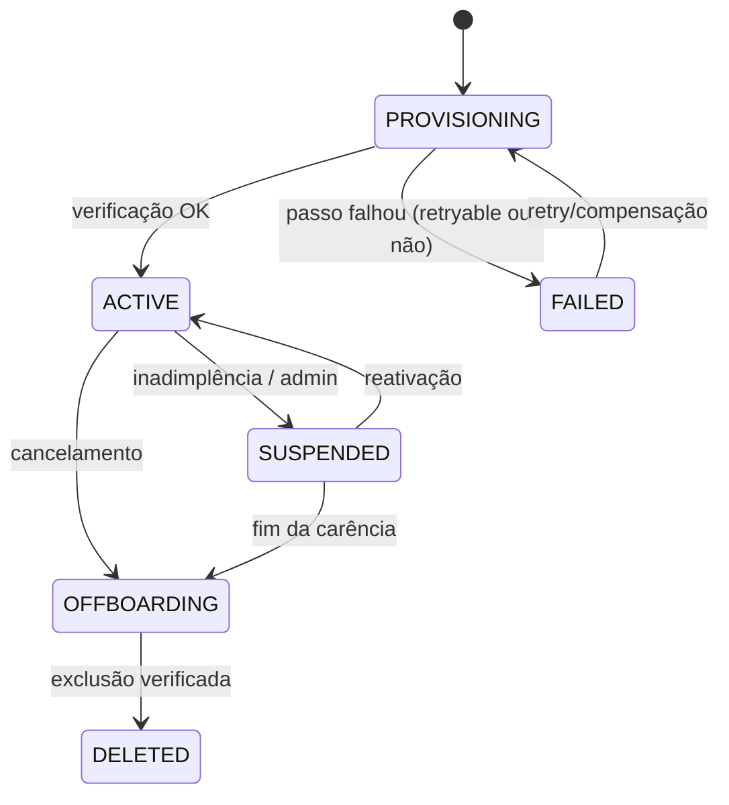

# EP-09 — Provisionamento ponta a ponta

> Prefixo: `ENT-PRV` · Sprints: S07–S10 · Tickets: 12 · Detalhamento: [tickets.md](tickets.md)

## Objetivo

Automatizar o fluxo da seção 11 do ADR: assinatura → organização `PROVISIONING` → database/roles → migrations → storage → identidade e segredos → rede → runtime (+ sidecar) → verificação positiva **e negativa** → ativação → evento para a UI, com compensação idempotente e **sem acesso parcial inseguro**. Inclui suspensão/reativação, offboarding verificável, rollout de versões e reconciliação.

## Princípios

- O provisioner é o **componente mais privilegiado**: processo segregado, sem porta de entrada, credenciais administrativas inacessíveis a API, runtime, LLM e Tool Gateway (ADR 6.1 item 2; seção 4).
- Estado desejado declarativo (`TenantRuntimeSpec`, ADR-010) para migrar de Compose a k3s sem reescrever o fluxo.
- Nunca encaminhar strings de conexão, segredos ou identificadores de infraestrutura fornecidos pelo usuário (seção 4.3).
- Falha de pagamento **não** apaga dados (seção 11, offboarding).

## Máquina de estados do tenant

## Tickets

| ID | Título | Sprint | Tam. | Risco | Depende de |
| --- | --- | --- | --- | --- | --- |
| [ENT-PRV-001](tickets.md#ent-prv-001) | Máquina de estados do tenant e registro de execuções | S07 | M | ALTO | IAM-002, IAM-007 |
| [ENT-PRV-002](tickets.md#ent-prv-002) | `TenantRuntimeSpec` e driver Docker Compose | S07 | L | ALTO | ISO-002, RUN-002, FND-003 |
| [ENT-PRV-003](tickets.md#ent-prv-003) | Serviço Provisioner segregado e acesso restrito ao Docker | S07 | L | CRÍTICO | PRV-001, DEC-006, ISO-001 |
| [ENT-PRV-008](tickets.md#ent-prv-008) | Webhook de assinatura (simulado) idempotente | S08 | M | ALTO | PRV-001, DEC-012 |
| [ENT-PRV-004](tickets.md#ent-prv-004) | Passos de dados: banco, migrations, storage, segredos, identidade | S08 | L | CRÍTICO | PRV-003, DAT-002, DAT-003, DAT-006, MSG-002 |
| [ENT-PRV-005](tickets.md#ent-prv-005) | Passos de rede e implantação do runtime | S08 | L | CRÍTICO | PRV-004, ISO-003, ISO-006 |
| [ENT-PRV-006](tickets.md#ent-prv-006) | Verificação pós-provisionamento e ativação | S08 | M | CRÍTICO | PRV-005, RUN-003 |
| [ENT-PRV-007](tickets.md#ent-prv-007) | Compensação, retry e falha segura | S09 | M | ALTO | PRV-004..006 |
| [ENT-PRV-009](tickets.md#ent-prv-009) | Suspensão e reativação | S09 | M | ALTO | PRV-006 |
| [ENT-PRV-011](tickets.md#ent-prv-011) | Rollout versionado do runtime | S09 | M | ALTO | PRV-005, DAT-003 |
| [ENT-PRV-012](tickets.md#ent-prv-012) | Reconciliador e controle de admissão por capacidade | S09 | M | ALTO | PRV-006, RUN-007, OBS-002 |
| [ENT-PRV-010](tickets.md#ent-prv-010) | Offboarding, exportação e exclusão verificável | S10 | L | ALTO | PRV-009, RAG-004, DAT-007 |

## Critério de saída

Evento de assinatura simulado cria tenant `ACTIVE` sem intervenção humana em tempo-alvo medido; tenant de teste com verificação negativa aprovada; falhas induzidas em cada passo terminam em estado seguro e recuperável; suspensão/reativação preservam dados.

## Riscos

- Acesso ao daemon Docker equivale a root no host: mitigação por *socket proxy* restrito, rede/identidade exclusivas e validação de spec (ISO-002) — **risco residual explícito** a registrar no ADR.
- Concorrência de provisionamentos simultâneos disputando recursos do host: fila serial por padrão.
