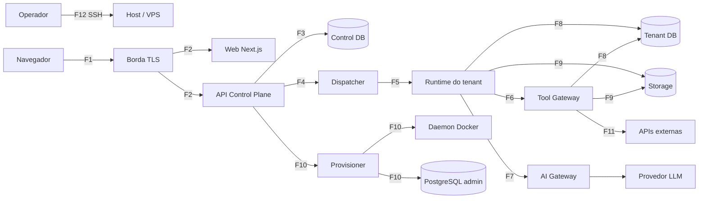

# Threat model STRIDE por fronteira de confiança — 2026-10-25

> **Versão:** 0.1 (rascunho para revisão humana) · **Data:** 2026-10-25 · **Ticket:** [ENT-DEC-001](../backlog/EP-00-decisoes-pocs-e-threat-model/tickets.md#ent-dec-001)
> **Autor:** agente executor (Claude Sonnet 5.5) · **Revisão (AC-3):** **pendente** (revisor previsto: o usuário, pessoa diferente do autor) · **Divergências registradas:** nenhuma até a revisão.
> **Base normativa:** [ADR consolidado](../transversal/2026-10-25-nucleos-enterprise-adr-arquitetura-mvp-e-evolucao.md) seções 1, 4–8, 15 e 16. Rastreabilidade: [rastreabilidade](../backlog/rastreabilidade.md).
> Não contém segredos, dados pessoais ou valores de `.env`.

## 1. Escopo e premissas

- **Objetivo:** ancorar os controles e os testes SEC-01..18 antes de qualquer código de fronteira. **Prioridade absoluta (ADR 1):** impedir acesso entre tenants, inclusive por agentes de IA e ferramentas.
- **Fora do escopo:** pentest ([GATE-004](../backlog/EP-12-gate-de-seguranca-e-go-no-go/tickets.md)); correção das ameaças (tickets próprios); estágios 2/3 de [futuro.md](../backlog/futuro.md).
- **Premissas do ADR:** cenário A (uma VPS, Docker Compose, PostgreSQL compartilhado por instância, LLM externa via gateway); o LLM não participa de decisão de segurança (ADR 8.1); `tenant_id` em job/payload não é prova de autorização (ADR 5.1).
- **Atacantes considerados:** usuário de um tenant; admin de tenant malicioso; conteúdo externo não confiável (e-mail, documento, página web); runtime de tenant comprometido; insider com acesso de operação; atacante externo na internet.
- **Convenções:** tickets citados sem o prefixo `ENT-` (ex.: `IAM-004`); "novo" = controle ausente do ADR, proposto aqui; todo ticket citado existe em `documentacoes/backlog/EP-*/tickets.md` (verificado por script, seção 8). Ativos: A1 dados do tenant (DB/RAG/memória), A2 credenciais e segredos, A3 integridade de jobs/políticas, A4 orçamento de IA, A5 host e kernel, A6 logs/traces, A7 backups.

## 2. Diagrama de fluxo de dados e fronteiras

Fronteiras: F1 Navegador↔Borda · F2 Borda↔Web/API · F3 API↔Control DB · F4 API↔Dispatcher · F5 Dispatcher↔Runtime · F6 Runtime↔Tool Gateway · F7 Runtime↔AI Gateway↔Provedor LLM · F8 Runtime/Tool Gateway↔Tenant DB · F9 Runtime/Tool Gateway↔Storage · F10 Provisioner↔daemon Docker↔PostgreSQL administrativo · F11 Tool Gateway↔APIs externas · F12 Operador↔Host (SSH).

> **Lacuna aberta (L-01/L-02 da rastreabilidade):** posição e credenciais do Tool Gateway (por tenant × serviço único) e leitura de dados privados pela UI dependem de [DEC-013](../backlog/EP-00-decisoes-pocs-e-threat-model/tickets.md#ent-dec-013)/ADR-025. Este modelo cobre as duas variantes nos controles; revisar quando o ADR-025 sair.

## 3. STRIDE por fronteira

Legenda: S spoofing · T tampering · R repudiation · I information disclosure · D denial of service · E elevation. Colunas: ameaça · ativo · controle do ADR · controle novo · ticket(s) · teste SEC.

### F1 — Navegador ↔ Borda

| STRIDE | Ameaça | Ativo | Controle do ADR | Controle novo | Ticket | SEC |
| --- | --- | --- | --- | --- | --- | --- |
| S | Roubo/fixação de sessão, credential stuffing | Sessão | Tenant resolvido no servidor por sessão (5.1) | Sessão opaca revogável, MFA, limite de tentativas | IAM-003, IAM-004, DEC-002 | SEC-01 |
| T | Adulteração de request, CSRF, XSS | Integridade | — | CSP, cookies SameSite/HttpOnly, anti-CSRF | WEB-008, FND-007 | SEC-01 |
| R | Usuário nega ação sensível | Auditoria | Auditoria (10) | Evento de segurança append-only com ator e IP | IAM-008 | SEC-13 |
| I | TLS fraco, cabeçalhos ausentes, enumeração de IDs | A1 | Aceite de segurança (15) | TLS, HSTS, respostas 403/404 indistinguíveis | FND-007, IAM-004 | SEC-01 |
| D | Inundação de requests | Disponibilidade | — | Rate limit na borda e por conta | FND-007, IAM-003 | SEC-17 |
| E | Usuário comum alcança funções de plataforma | Backoffice | RBAC/ABAC (5.2) | Separação de papéis de plataforma e backoffice | IAM-005, WEB-009 | SEC-01 |

### F2 — Borda ↔ Web/API

| STRIDE | Ameaça | Ativo | Controle do ADR | Controle novo | Ticket | SEC |
| --- | --- | --- | --- | --- | --- | --- |
| S | Cabeçalho `X-Forwarded-*`/tenant forjado | Contexto de tenant | Tenant nunca vem do corpo (5.1) | Proxy sobrescreve cabeçalhos; API ignora tenant do cliente como autoridade | FND-007, IAM-004 | SEC-01, SEC-07 |
| T | `tenant_id` adulterado em rota/URL | A1 | Rota é contexto solicitado, verificada (5.1) | Verificação de membership por operação | IAM-004, IAM-005 | SEC-07 |
| R | Falta de trilha de acessos negados | Auditoria | — | Registrar negativas de autorização | IAM-008 | SEC-13 |
| I | IDOR entre tenants; erros verbosos | A1 | Deny-by-default (5.2) | Harness A/B em toda rota; erro padronizado | IAM-010, IAM-005 | SEC-01 |
| D | Requisições caras, upload gigante | Disponibilidade | — | Limites de payload e timeouts | IAM-001, FND-007 | SEC-17 |
| E | Mass assignment altera papel/entitlement | Autorização | — | DTO com allowlist; validação de contrato | IAM-001, IAM-007 | SEC-01 |

### F3 — API ↔ Control DB

| STRIDE | Ameaça | Ativo | Controle do ADR | Controle novo | Ticket | SEC |
| --- | --- | --- | --- | --- | --- | --- |
| S | Runtime usa credencial do control DB | Control DB | Runtime sem acesso ao banco de controle (6.1, 7) | Credenciais distintas por serviço | IAM-002, DAT-005 | SEC-03 |
| T | Alteração de membership/política | A3 | Metadados mínimos (6.1.9) | Migrations por identidade própria; histórico imutável | IAM-002, IAM-006 | SEC-03 |
| R | Mudança administrativa sem autor | Auditoria | Acesso excepcional auditado (5.1) | Auditoria append-only | IAM-008, IAM-009 | SEC-13 |
| I | Cópia de dados privados para o control DB | A1 | Metadados mínimos (6.1.9) | Revisão de esquema contra dados privados | IAM-002, DEC-013 | SEC-03 |
| D | Consulta pesada trava o banco | Disponibilidade | — | Timeouts e pool por serviço | IAM-002 | SEC-18 |
| E | SQL injection eleva privilégios | A2 | Sem superuser (6.1.1) | ORM/consultas parametrizadas; role mínima | DEC-003, IAM-002 | SEC-03 |

### F4 — API ↔ Dispatcher

| STRIDE | Ameaça | Ativo | Controle do ADR | Controle novo | Ticket | SEC |
| --- | --- | --- | --- | --- | --- | --- |
| S | Produtor falso publica job | A3 | Produtor validado ao publicar (9) | Envelope assinado e outbox | MSG-001, DEC-004 | SEC-07 |
| T | `tenant_id` do job adulterado | A3 | `tenant_id` é metadado, não prova (5.1) | Assinatura cobre tenant, agente e audiência | MSG-001, MSG-002 | SEC-07 |
| R | Job sem rastro de origem | Auditoria | Auditoria (9) | `job_id`, ator e correlação persistidos | MSG-001, IAM-008 | SEC-13 |
| I | Payload sensível em fila | A1 | Minimização (8.2) | Payload por referência, não por conteúdo | MSG-001 | SEC-13 |
| D | Rajada de um tenant esgota fila | Disponibilidade | Idempotência e limites (9) | Justiça por tenant e limites | MSG-005, MSG-004 | SEC-17 |
| E | Confused deputy: Dispatcher age com mais poder que o chamador | A3 | Autorização reavaliada (5.2) | Dispatcher reautoriza com a identidade do originador | MSG-003, TGW-001 | SEC-07 |

### F5 — Dispatcher ↔ Runtime

| STRIDE | Ameaça | Ativo | Controle do ADR | Controle novo | Ticket | SEC |
| --- | --- | --- | --- | --- | --- | --- |
| S | Runtime B recebe/consome tarefa de A | A3 | Runtime confirma que a tarefa é sua (5.1) | Identidade de serviço por runtime (mTLS/token curto) | MSG-002, DEC-004 | SEC-07 |
| T | Replay ou mutação de tarefa | A3 | Idempotência por evento (9) | Nonce, expiração e *lease* | MSG-003, MSG-007 | SEC-07 |
| R | Execução negada depois | Auditoria | Auditoria (9) | Ack/nack e transições registrados | MSG-003, MSG-004 | SEC-13 |
| I | Broker exposto a tenants | A1 | Broker não exposto com acesso amplo (9) | Fila lógica por tenant com ACL | MSG-003, ISO-005 | SEC-04 |
| D | Runtime travado retém tarefas | Disponibilidade | Tentativas limitadas, DLQ (9) | Heartbeat, expiração de *lease*, reconciliação | MSG-003, MSG-004 | SEC-18 |
| E | Runtime assume tarefas de outro tenant | A1 | Isolamento (9) | Rejeição no consumidor por audiência | MSG-002, MSG-007 | SEC-07 |

### F6 — Runtime ↔ Tool Gateway

| STRIDE | Ameaça | Ativo | Controle do ADR | Controle novo | Ticket | SEC |
| --- | --- | --- | --- | --- | --- | --- |
| S | Runtime A se apresenta como B ao gateway | A1 | Identidade resolvida no backend (8.1) | Identidade de serviço verificada; tenant nunca vem do argumento | TGW-001, MSG-002 | SEC-05, SEC-09 |
| T | Argumentos gerados pelo LLM (tenant, caminho, URL, SQL) | A1 | Não confiar em argumentos do LLM (5.2) | Validação por esquema; sem SQL/shell livres | TGW-001, TGW-003 | SEC-05 |
| R | Ação de ferramenta sem trilha | Auditoria | Evento de segurança sem vazar o documento (8.3) | Auditoria por invocação | TGW-001, IAM-008 | SEC-13 |
| I | Resposta de ferramenta devolve dado de outro tenant ou segredo | A1, A2 | Retornar só o autorizado (8.1) | Filtro de saída e redação | TGW-003, TGW-006 | SEC-05, SEC-10 |
| D | Loop de chamadas a ferramentas | Disponibilidade | — | Limites por execução e timeout | TGW-001, RUN-004 | SEC-17 |
| E | Ferramenta fora da lista do agente; ação sensível sem aprovação | A3 | Deny-by-default e aprovação humana (5.2) | Política testada; aprovação durável | TGW-002, RUN-005 | SEC-05 |

### F7 — Runtime ↔ AI Gateway ↔ Provedor LLM

| STRIDE | Ameaça | Ativo | Controle do ADR | Controle novo | Ticket | SEC |
| --- | --- | --- | --- | --- | --- | --- |
| S | Runtime consome orçamento de outro tenant | A4 | Custos por tenant (ADR-015) | Chave/identidade por tenant no gateway | AIG-001, AIG-002 | SEC-17 |
| T | Prompt injection altera instruções do sistema | A3 | Entrada externa é não confiável (8.2) | Defesas de fronteira; LLM sem poder de decisão | TGW-006, RUN-004 | SEC-10 |
| R | Custo sem atribuição | A4 | ADR-015 | Metering por tenant e agente | AIG-003 | SEC-17 |
| I | Segredos e dados em excesso enviados ao provedor | A1, A2 | Mínimo necessário; sem segredos no prompt (8.2) | Montagem de contexto com minimização e redação; processo LGPD | AIG-001, DEC-011 | SEC-10 |
| D | Denial of wallet; rajada de LLM | A4 | Quotas (8.2, 12) | Quotas, rate limit e teto de orçamento | AIG-002, GATE-002 | SEC-17 |
| E | Resposta do modelo dispara ação além da política | A3 | LLM só propõe (5.2) | Validação de toda ação proposta no Tool Gateway | TGW-001, RUN-004 | SEC-05 |

### F8 — Runtime/Tool Gateway ↔ Tenant DB

| STRIDE | Ameaça | Ativo | Controle do ADR | Controle novo | Ticket | SEC |
| --- | --- | --- | --- | --- | --- | --- |
| S | Runtime A conecta ao DB B | A1 | Uma credencial por runtime; ACL por database (6.1) | Suíte adversarial | DAT-002, DAT-005 | SEC-02 |
| T | Migration aplicada na base errada | A1 | Migrations por identidade separada, base correta (6.1.7) | Runner com verificação de alvo | DAT-003, DEC-003 | SEC-02, SEC-16 |
| R | Alteração de dados sem rastro | Auditoria | — | Auditoria de acesso administrativo | IAM-008, DAT-001 | SEC-13 |
| I | Role herdada, `PUBLIC`, objetos compartilhados, índice vetorial global | A1 | `REVOKE`, ACLs, pgvector na base do tenant (6.1) | Testes de ACL efetiva; sem índice global | DAT-001, DAT-004, RAG-002 | SEC-02, SEC-06 |
| D | Consulta de um tenant degrada a instância compartilhada | Disponibilidade | Risco residual explícito (6.1) | Limites de conexão e timeout por role | DAT-001, RUN-007 | SEC-17 |
| E | Role com `CREATEDB`/`BYPASSRLS`/superuser | A1 | Proibido (6.1.1) | Verificação automatizada de atributos | DAT-001, DAT-005 | SEC-02, SEC-03 |

### F9 — Runtime/Tool Gateway ↔ Storage

| STRIDE | Ameaça | Ativo | Controle do ADR | Controle novo | Ticket | SEC |
| --- | --- | --- | --- | --- | --- | --- |
| S | URL assinada reutilizada por outro tenant | A1 | URL gerada após autorização (10) | Assinatura vinculada ao tenant, curta | DAT-006, DEC-009 | SEC-08 |
| T | Sobrescrita de objeto alheio | A1 | Prefixos/buckets por tenant (10) | Política que nega objetos alheios | DAT-006 | SEC-08 |
| R | Download sem trilha | Auditoria | — | Evento por acesso a objeto | DAT-006, IAM-008 | SEC-13 |
| I | Enumeração de object key | A1 | Conferir key e ownership (10) | Chaves não previsíveis | DAT-006, RAG-001 | SEC-08 |
| D | Upload ilimitado | Disponibilidade | — | Quotas e volumes por tenant | ISO-006, DAT-006 | SEC-17 |
| E | Arquivo malicioso executado no pipeline | A5 | Sem OCR/browser no MVP (ADR-013) | Ingestão sem execução de conteúdo | RAG-001 | SEC-10 |

### F10 — Provisioner ↔ daemon Docker ↔ PostgreSQL administrativo

| STRIDE | Ameaça | Ativo | Controle do ADR | Controle novo | Ticket | SEC |
| --- | --- | --- | --- | --- | --- | --- |
| S | API ou runtime fala com o Provisioner como se fosse legítimo | A5 | Provisioner restrito, daemon não exposto (4) | Autenticação de serviço e escopo mínimo | PRV-003, DEC-004 | SEC-11 |
| T | Spec de runtime adulterada (privileged, mounts) | A5 | Configuração mínima do runtime (7) | Policy-as-code sobre a spec | ISO-002, PRV-002 | SEC-11 |
| R | Operação privilegiada sem registro | Auditoria | — | Registro de execuções por passo | PRV-001, IAM-008 | SEC-13 |
| I | Credencial administrativa vaza | A2 | Credencial admin segregada (6.1.2, 10) | Gestão de segredos; admin fora do runtime | DEC-006, PRV-003 | SEC-15 |
| D | Provisionamento falho deixa estado parcial | Disponibilidade | Falha segura (11) | Compensação idempotente | PRV-007, PRV-012 | SEC-18 |
| E | Acesso ao Docker equivale a root no host (L-05) | A5 | Sem socket para tenants (7) | Socket proxy e risco residual explícito | PRV-003, ISO-002 | SEC-11 |

### F11 — Tool Gateway ↔ APIs externas

| STRIDE | Ameaça | Ativo | Controle do ADR | Controle novo | Ticket | SEC |
| --- | --- | --- | --- | --- | --- | --- |
| S | Agente A usa token de integração de B | A2 | Credenciais exclusivas por tenant (10) | Cofre por tenant; credencial resolvida pelo gateway | TGW-004 | SEC-09 |
| T | Resposta externa manipulada (injeção indireta) | A3 | Entrada externa não confiável (8.2) | Marcação e isolamento de conteúdo externo | TGW-006, TGW-005 | SEC-10 |
| R | Ação externa sem trilha | Auditoria | Aprovação humana para ações sensíveis (5.2) | Auditoria e aprovação | RUN-005, IAM-008 | SEC-13 |
| I | Exfiltração via ferramenta HTTP; SSRF para metadata/localhost/IP privado; DNS rebinding | A1 | Egress limitado (7) | Allowlist, resolução e validação de IP, bloqueio de redes privadas | ISO-004, TGW-005 | SEC-12 |
| D | API externa lenta ou fora do ar | Disponibilidade | — | Timeouts, circuit breaker | TGW-005, MSG-004 | SEC-18 |
| E | Escopo OAuth maior que o necessário | A2 | Mínimo privilégio | Escopos mínimos por conector | TGW-005, TGW-004 | SEC-09 |

### F12 — Operador ↔ Host (SSH)

| STRIDE | Ameaça | Ativo | Controle do ADR | Controle novo | Ticket | SEC |
| --- | --- | --- | --- | --- | --- | --- |
| S | Chave SSH roubada | A5 | Host atualizado (4.1) | SSH só por chave, sem root, MFA/bastion quando viável | ISO-001 | SEC-11 |
| T | Alteração manual de configuração | A5 | — | Baseline declarativo e detecção de deriva | ISO-001, PRV-012 | SEC-16 |
| R | Ação do operador sem trilha | Auditoria | Acesso excepcional auditado (5.1) | Auditoria e break-glass | IAM-009, ISO-001 | SEC-13 |
| I | Operador lê dados de tenants, segredos ou backups | A1, A2, A7 | Risco residual de administrador (16.1) | Break-glass temporário; backup criptografado; dossiê | IAM-009, DAT-007, GATE-007 | SEC-14 |
| D | Erro de operação derruba o host | Disponibilidade | RPO/RTO pendentes (16.10) | Runbooks, alertas e simulação | OBS-004, OBS-005, GATE-005 | SEC-18 |
| E | Insider com root vê tudo (kernel e administrador compartilhados) | A5 | Limite de garantia declarado (1) | Aceito como RISK-001; dossiê ao cliente | GATE-007, GATE-004 | SEC-04 |

## 4. Casos de abuso obrigatórios

| ID | Caso | Cenário resumido | Controles | Tickets | SEC |
| --- | --- | --- | --- | --- | --- |
| AB-01 | IDOR entre tenants | Usuário A troca o ID de recurso para um de B | Verificação de ownership no servidor; resposta 403/404 indistinta | IAM-004, IAM-005, IAM-010 | SEC-01 |
| AB-02 | `tenant_id` adulterado em job/token/URL | A altera o campo em fila, token ou rota | Envelope assinado; audiência; rejeição no consumidor | MSG-001, MSG-002, MSG-007, IAM-004 | SEC-07 |
| AB-03 | Confused deputy no Dispatcher | Dispatcher executa com poder maior que o originador | Reautorização com identidade do originador | MSG-003, TGW-001 | SEC-07 |
| AB-04 | Prompt injection direta e indireta | Instrução em chat, e-mail, documento ou página web pede dados/segredos de B | LLM sem decisão; Tool Gateway deny-by-default; conteúdo externo não confiável | TGW-006, RAG-003, TGW-001 | SEC-05, SEC-10 |
| AB-05 | Documento envenenado no RAG | Documento com instruções ou embedding forjado | Índice na base do tenant; filtro de isolamento; ingestão sem execução | RAG-001, RAG-002, RAG-003 | SEC-06, SEC-10 |
| AB-06 | SSRF e DNS rebinding | Ferramenta HTTP aponta para metadata, localhost, IP privado ou domínio que muda de IP | Egress controlado; validação após resolução | ISO-004, TGW-005 | SEC-12 |
| AB-07 | Exfiltração via ferramenta HTTP | Dado codificado em URL/corpo para destino do atacante | Allowlist de destinos; auditoria; aprovação para ações externas | TGW-005, RUN-005 | SEC-12 |
| AB-08 | Admin de tenant malicioso | Admin cria conector, agente ou política para escalar | Limites de papel; políticas validadas no Control Plane | IAM-005, TGW-002, TGW-004 | SEC-01, SEC-09 |
| AB-09 | Insider com acesso de operação | Operador lê bases, segredos ou backups | Break-glass; cofre; backup criptografado; dossiê | IAM-009, DEC-006, DAT-007 | SEC-13, SEC-14 |
| AB-10 | Credencial de runtime vazada | Credencial de A obtida por log, imagem ou memória | Rotação e revogação por tenant; redação de logs | DAT-009, MSG-002, OBS-001 | SEC-15, SEC-13 |
| AB-11 | Denial of wallet | Rajada de chamadas esgota orçamento de LLM | Quota, rate limit, teto de orçamento | AIG-002, AIG-003, MSG-005 | SEC-17 |
| AB-12 | Fuga de container | Runtime explora capability, socket ou kernel | Hardening; sem socket; redes por tenant; userns | ISO-002, ISO-003, PRV-003, ISO-008, DEC-005 | SEC-04, SEC-11 |

## 5. Registro de riscos residuais (RISK)

Origem: seção 16 do ADR. **Responsável:** proposto em todos os casos como "dono do produto (nome a confirmar pelo revisor)", pois o modelo não pode nomear pessoas sem decisão humana. **Estado de aceite:** todos *propostos*, nenhum aceito até a revisão (AC-2 depende dessa confirmação).

| ID | Risco | Prob. | Impacto | Mitigação | Contingência | Gatilho de revisão | Tickets |
| --- | --- | --- | --- | --- | --- | --- | --- |
| RISK-001 | VPS única; kernel e administrador compartilhados | M | Alto | Hardening, redes por tenant, dossiê ao cliente | Migrar tenant sensível para host dedicado | Exigência contratual; PoC DEC-005 falhar | DEC-005, ISO-001..003, GATE-007 |
| RISK-002 | Instância PostgreSQL compartilhada | M | Alto | ACLs, role por tenant, suíte adversarial | Segregar fisicamente a base | Falha SEC-02/03; exigência contratual | DAT-001, DAT-002, DAT-005 |
| RISK-003 | LLM externa e LGPD | A | Alto | Minimização, contrato, processo LGPD | Trocar provedor/desligar módulo | Mudança de termos do provedor | DEC-011, AIG-001, GATE-007 |
| RISK-004 | Ferramentas externas com permissões próprias | M | Médio | Escopos mínimos, cofre por tenant | Revogar conector | Novo conector real | TGW-004, TGW-005 |
| RISK-005 | Observabilidade como fonte de vazamento | M | Alto | Redação, segregação por tenant | Purga de logs; desligar coleta | Falha SEC-13 | DEC-010, FND-009, OBS-001, OBS-003 |
| RISK-006 | Código arbitrário e browser automation | B | Alto | Proibidos no MVP | Sandbox em MicroVM ([futuro.md](../backlog/futuro.md)) | Pedido de capacidade | RUN-004, TGW-001 |
| RISK-007 | Orquestração: filas vs Temporal | M | Médio | PoC DEC-007 | Trocar o motor | Resultado do PoC | DEC-007, MSG-001..007 |
| RISK-008 | Custo e CPU compartilhada da VPS | M | Médio | Benchmark, quotas | Limitar admissão de tenants | Falha GATE-002/006 | RUN-007, GATE-002, GATE-006 |
| RISK-009 | Criptografia e gestão de chaves | M | Alto | Backup criptografado; rotação | Reemitir chaves | Cliente regulado | DEC-006, DAT-007, TGW-004 |
| RISK-010 | Disponibilidade, RPO/RTO e resposta a incidentes | M | Alto | Backups externos, simulação | Plano de DR | Antes da comercialização | DAT-007, DAT-008, OBS-005, GATE-005 |
| RISK-011 | Escalada via acesso do Provisioner ao Docker (L-05) | M | Alto | Socket proxy, escopo mínimo | Desativar provisionamento automático | Alteração do driver de runtime | PRV-003, ISO-002 |
| RISK-012 | Lacuna L-01/L-02: posição do Tool Gateway e leitura da UI indefinidas | M | Médio | DEC-013 antes de EP-07 | Ajustar este modelo | Publicação do ADR-025 | DEC-013 |

Escala: B baixa, M média, A alta (avaliação qualitativa do autor, sujeita à revisão).

## 6. Matriz ameaça → ticket → teste

Cada SEC do gate (ADR 15) com ameaças que o cobrem, tickets que o implementam e onde nasce o teste, conforme [rastreabilidade](../backlog/rastreabilidade.md) seção 2.

| SEC | Ameaças/casos (seção 3 e 4) | Tickets de controle | Teste construído em | Consolidado |
| --- | --- | --- | --- | --- |
| SEC-01 | F1, F2 (IDOR, mass assignment); AB-01, AB-08 | IAM-004, IAM-005, IAM-010, WEB-008 | IAM-004, IAM-010 | GATE-001 |
| SEC-02 | F8 (S, T, I, E) | DAT-001, DAT-002, DAT-005 | DAT-002, DAT-005 | GATE-001 |
| SEC-03 | F3, F8 (E) | IAM-002, DAT-005 | DAT-005, IAM-002 | GATE-001 |
| SEC-04 | F5 (I), F12 (E); AB-12 | ISO-003, ISO-005, ISO-006 | ISO-003, ISO-006, ISO-008 | GATE-001 |
| SEC-05 | F6 (S, T, I, E); F7 (E); AB-04 | TGW-001, TGW-002, TGW-003 | TGW-001..003, RAG-003 | GATE-001 |
| SEC-06 | F8 (I); AB-05 | DAT-004, RAG-002, RAG-003 | DAT-004, RAG-002, RAG-003 | GATE-001 |
| SEC-07 | F2 (S, T); F4; F5; AB-02, AB-03 | MSG-001, MSG-002, MSG-003 | MSG-001..003, MSG-007 | GATE-001 |
| SEC-08 | F9 (S, T, I) | DAT-006, DEC-009 | DAT-006 | GATE-001 |
| SEC-09 | F6 (S); F11 (S, E); AB-08 | TGW-004, TGW-005 | TGW-004 | GATE-001 |
| SEC-10 | F6 (I); F7 (T, I); F9 (E); F11 (T); AB-04, AB-05 | TGW-006, RAG-001, RAG-003 | TGW-006, RAG-003 | GATE-001 |
| SEC-11 | F10; F12; AB-12 | ISO-002, PRV-003, ISO-008 | ISO-002, PRV-003, ISO-008 | GATE-001 |
| SEC-12 | F11 (I); AB-06, AB-07 | ISO-004, TGW-005 | ISO-004, TGW-005, ISO-008 | GATE-001 |
| SEC-13 | Repúdio e vazamento por log: F1..F12 (R); AB-09, AB-10 | IAM-008, OBS-001, OBS-003 | IAM-008, OBS-001, OBS-003 | GATE-001 |
| SEC-14 | F12 (I); AB-09; RISK-010 | DAT-007, DAT-008 | DAT-007, DAT-008 | GATE-001, GATE-005 |
| SEC-15 | F10 (I); AB-10 | DAT-009, MSG-002, TGW-004, DEC-006 | MSG-002, TGW-004, DAT-009 | GATE-001 |
| SEC-16 | F8 (T); F12 (T); estado pós-provisionamento | PRV-006, DAT-005, ISO-008 | PRV-006 | GATE-001 |
| SEC-17 | F1 (D), F4 (D), F7 (D), F8 (D), F9 (D); AB-11 | AIG-002, MSG-005, RUN-007 | AIG-002, MSG-005, RUN-007 | GATE-002 |
| SEC-18 | F3 (D), F5 (D), F10 (D), F11 (D), F12 (D) | MSG-007, PRV-007 | MSG-007, PRV-007 | GATE-003 |

Ameaças sem SEC correspondente (testadas por outro meio, sem lacuna aceita): XSS/CSRF e cabeçalhos (WEB-008, FND-007) e supply chain de imagens (ISO-007, FND-005). Ver proposta de ajustes (seção 7).

## 7. Proposta de ajustes ao backlog (não aplicada; o backlog não foi alterado)

1. Criar linha ou nota em [rastreabilidade](../backlog/rastreabilidade.md) apontando esta matriz como fonte das ameaças (feito apenas como proposta; DEC-001 não altera o backlog).
2. Considerar teste SEC adicional (fora do gate 01..18) para cabeçalhos/CSRF/XSS (WEB-008) e supply chain (ISO-007).
3. Incluir em PRV-003 critério explícito para RISK-011 (aceite documentado do poder do Docker).
4. Incluir em DEC-013 a decisão da posição do Tool Gateway como pré-requisito de EP-07 (RISK-012).
5. Confirmar o responsável nomeado de cada RISK (AC-2).

## 8. Verificação do documento

Script usado na entrega (reproduzível; ver documento de entrega): confirma que SEC-01..18 aparecem na matriz da seção 6, que todo ticket citado existe no backlog e que há 12 fronteiras com 6 linhas STRIDE cada.

## 9. Histórico e revisão

| Versão | Data | Autor | Revisor | Estado |
| --- | --- | --- | --- | --- |
| 0.1 | 2026-10-25 | agente executor (Claude Sonnet 5.5) | pendente | Rascunho; aguarda revisão humana (AC-3) |

Divergências da revisão: a preencher pelo revisor.
