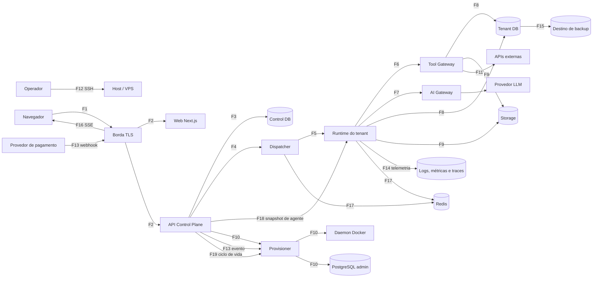

# Threat model STRIDE por fronteira de confiança — 2026-10-25

> **Versão:** 0.2 (rascunho para revisão humana) · **Data:** 2026-10-25 · **Ticket:** [ENT-DEC-001](../backlog/EP-00-decisoes-pocs-e-threat-model/tickets.md#ent-dec-001)
> **Autor:** agente executor (Claude Sonnet 5.5) · **Revisão (AC-3):** **pendente** (revisor previsto: o usuário, pessoa diferente do autor; a revisão e a auditoria de agentes não substituem a revisão humana) · **Aceite de RISK com responsável nomeado (AC-2):** **pendente** · **Divergências registradas:** nenhuma até a revisão humana.
> **Base normativa:** [ADR consolidado](../transversal/2026-10-25-nucleos-enterprise-adr-arquitetura-mvp-e-evolucao.md) seções 1, 4–8, 10, 11, 15 e 16. Rastreabilidade: [rastreabilidade](../backlog/rastreabilidade.md).
> Não contém segredos, dados pessoais ou valores de `.env`.

## 1. Escopo e premissas

- **Objetivo:** ancorar os controles e os testes SEC-01..18 antes de qualquer código de fronteira. **Prioridade absoluta (ADR 1):** impedir acesso entre tenants, inclusive por agentes de IA e ferramentas.
- **Fora do escopo:** pentest ([GATE-004](../backlog/EP-12-gate-de-seguranca-e-go-no-go/tickets.md)); correção das ameaças (tickets próprios); estágios 2/3 de [futuro.md](../backlog/futuro.md); alteração do backlog (somente propostas na seção 7).
- **Premissas do ADR:** cenário A (uma VPS, Docker Compose, PostgreSQL compartilhado por instância, LLM externa via gateway); o LLM não participa de decisão de segurança (ADR 8.1); `tenant_id` em job/payload não é prova de autorização (ADR 5.1).
- **Atacantes considerados:** usuário de um tenant; admin ou owner de tenant malicioso; conteúdo externo não confiável (e-mail, documento, página web, saída do modelo); runtime de tenant comprometido; insider com acesso de operação; atacante externo anônimo na internet; **provedor de pagamento como origem não confiável do webhook (F13)**.
- **Convenções:** tickets citados sem o prefixo `ENT-` (ex.: `IAM-004`). "Controle do ADR" é o que o ADR diz; "controle novo" é o que um ticket do backlog especifica além do ADR. Quando não há controle no backlog, a célula diz **"sem controle no backlog"** ou **"Proposto, sem ticket"** e aponta um RISK; nenhum controle é inventado. **`16.n` = item `n` da lista numerada da seção 16 do ADR** (não é subseção). Cada ameaça tem ID `T-Fn-X` (`n` = fronteira, `X` = S/T/R/I/D/E; segunda linha da mesma categoria recebe o sufixo `2`, ex.: `T-F1-I2`). Ativos: A1 dados do tenant (DB/RAG/memória), A2 credenciais e segredos, A3 integridade de jobs/políticas, A4 orçamento de IA, A5 host e kernel, A6 logs/traces, A7 backups. Todo ticket citado existe em `documentacoes/backlog/EP-*/tickets.md` e as demais checagens são feitas pelo script versionado (seção 8).

## 2. Diagrama de fluxo de dados e fronteiras



Fronteiras: F1 Navegador↔Borda · F2 Borda↔Web/API · F3 API↔Control DB · F4 API↔Dispatcher · F5 Dispatcher↔Runtime · F6 Runtime↔Tool Gateway · F7 Runtime↔AI Gateway↔Provedor LLM · F8 Runtime/Tool Gateway↔Tenant DB · F9 Runtime/Tool Gateway↔Storage · F10 Provisioner↔daemon Docker↔PostgreSQL administrativo · F11 Tool Gateway↔APIs externas · F12 Operador↔Host (SSH) · **F13 Provedor de pagamento→Borda→API (webhook)→Provisioner · F14 Serviços/runtime→logs, métricas e traces · F15 Host/PostgreSQL/Storage→destino de backup e restore · F16 Navegador↔canal SSE · F17 Serviços↔Redis · F18 Control Plane→Runtime (snapshot de agente e política) · F19 ciclo de vida do tenant (suspensão, exportação, offboarding)**. F1..F12 são as 12 fronteiras exigidas pelo ticket; F13..F19 foram acrescentadas na v0.2 (seção 9).

> **Lacuna aberta (L-01/L-02 da rastreabilidade):** posição e credenciais do Tool Gateway (por tenant × serviço único) e leitura de dados privados pela UI dependem de [DEC-013](../backlog/EP-00-decisoes-pocs-e-threat-model/tickets.md#ent-dec-013)/ADR-025. Este modelo cobre as duas variantes nos controles; revisar quando o ADR-025 sair.

## 3. STRIDE por fronteira

Legenda: S spoofing · T tampering · R repudiation · I information disclosure · D denial of service · E elevation. Colunas: ID da ameaça (`T-Fn-X`) · ameaça · ativo · controle do ADR · controle novo · ticket(s) (ou RISK) · teste SEC. "sem SEC" significa fora dos testes 01..18 do gate (ver seção 6).

### F1 — Navegador ↔ Borda

| ID | STRIDE | Ameaça | Ativo | Controle do ADR | Controle novo | Ticket | SEC |
| --- | --- | --- | --- | --- | --- | --- | --- |
| T-F1-S | S | Roubo/fixação de sessão, credential stuffing | Sessão | Tenant resolvido no servidor por sessão (5.1) | Sessão opaca revogável, MFA, limite de tentativas | IAM-003, IAM-004, DEC-002 | SEC-01 |
| T-F1-T | T | Adulteração de request, CSRF, XSS | Integridade | — | CSP, cookies SameSite/HttpOnly, anti-CSRF | WEB-008, FND-007 | SEC-01 |
| T-F1-R | R | Usuário nega ação sensível | Auditoria | Auditoria (10) | Evento de segurança append-only com ator e IP | IAM-008 | SEC-13 |
| T-F1-I | I | TLS fraco, cabeçalhos ausentes, enumeração de IDs | A1 | Aceite de segurança (15) | TLS, HSTS, respostas 403/404 indistinguíveis | FND-007, IAM-004 | SEC-01 |
| T-F1-I2 | I | Saída do agente com markdown, imagem ou link renderizado exfiltra dados sem ferramenta, ou injeta conteúdo (XSS armazenado) | A1 | Entrada externa e saída do modelo não confiáveis (8.2) | Conteúdo de agente sanitizado por allowlist; sem links/imagens remotos renderizados automaticamente | WEB-008, TGW-006, RAG-003 | SEC-10 |
| T-F1-D | D | Inundação de requests | Disponibilidade | — | Rate limit na borda e por conta | FND-007, IAM-003 | SEC-17 |
| T-F1-E | E | Usuário comum alcança funções de plataforma | Backoffice | RBAC/ABAC (5.2) | Separação de papéis de plataforma e backoffice | IAM-005, WEB-009 | SEC-01 |

### F2 — Borda ↔ Web/API

| ID | STRIDE | Ameaça | Ativo | Controle do ADR | Controle novo | Ticket | SEC |
| --- | --- | --- | --- | --- | --- | --- | --- |
| T-F2-S | S | Cabeçalho `X-Forwarded-*`/tenant forjado | Contexto de tenant | Tenant nunca vem do corpo (5.1) | Proxy sobrescreve cabeçalhos; API ignora tenant do cliente como autoridade | FND-007, IAM-004 | SEC-01, SEC-07 |
| T-F2-T | T | `tenant_id` adulterado em rota/URL | A1 | Rota é contexto solicitado, verificada (5.1) | Verificação de membership por operação | IAM-004, IAM-005 | SEC-07 |
| T-F2-R | R | Falta de trilha de acessos negados | Auditoria | — | Registrar negativas de autorização | IAM-008 | SEC-13 |
| T-F2-I | I | IDOR entre tenants; erros verbosos | A1 | Deny-by-default (5.2) | Harness A/B em toda rota; erro padronizado | IAM-010, IAM-005 | SEC-01 |
| T-F2-D | D | Requisições caras, upload gigante | Disponibilidade | — | Limites de payload e timeouts | IAM-001, FND-007 | SEC-17 |
| T-F2-E | E | Mass assignment altera papel/entitlement | Autorização | — | DTO com allowlist; validação de contrato | IAM-001, IAM-007 | SEC-01 |

### F3 — API ↔ Control DB

| ID | STRIDE | Ameaça | Ativo | Controle do ADR | Controle novo | Ticket | SEC |
| --- | --- | --- | --- | --- | --- | --- | --- |
| T-F3-S | S | Runtime usa credencial do control DB | Control DB | Runtime sem acesso ao banco de controle (6.1, 7) | Credenciais distintas por serviço | IAM-002, DAT-005 | SEC-03 |
| T-F3-T | T | Alteração de membership/política | Membership é a fonte do tenant (5.1) | Metadados mínimos (6.1.9) | Migrations por identidade própria; histórico imutável | IAM-002, IAM-006 | SEC-03 |
| T-F3-R | R | Mudança administrativa sem autor | Auditoria | Acesso excepcional auditado (5.1) | Auditoria append-only | IAM-008, IAM-009 | SEC-13 |
| T-F3-I | I | Cópia de dados privados para o control DB | A1 | Metadados mínimos (6.1.9) | Revisão de esquema contra dados privados | IAM-002, DEC-013 | SEC-03 |
| T-F3-D | D | Consulta pesada trava o banco | Disponibilidade | — | Timeouts e pool por serviço | IAM-002 | SEC-18 |
| T-F3-E | E | SQL injection eleva privilégios | A2 | Sem superuser (6.1.1) | ORM/consultas parametrizadas; role mínima | DEC-003, IAM-002 | sem SEC no gate (testes de contrato e consulta parametrizada em DEC-003, IAM-002) |

### F4 — API ↔ Dispatcher

| ID | STRIDE | Ameaça | Ativo | Controle do ADR | Controle novo | Ticket | SEC |
| --- | --- | --- | --- | --- | --- | --- | --- |
| T-F4-S | S | Produtor falso publica job | A3 | Produtor validado ao publicar (9) | Envelope assinado e outbox | MSG-001, DEC-004 | SEC-07 |
| T-F4-T | T | `tenant_id` do job adulterado | A3 | `tenant_id` é metadado, não prova (5.1) | Assinatura cobre tenant, agente e audiência | MSG-001, MSG-002 | SEC-07 |
| T-F4-R | R | Job sem rastro de origem | Auditoria | Auditoria (9) | `job_id`, ator e correlação persistidos | MSG-001, IAM-008 | SEC-13 |
| T-F4-I | I | Payload sensível em fila | A1 | Minimização (8.2) | Payload por referência, não por conteúdo | MSG-001 | SEC-13 |
| T-F4-D | D | Rajada de um tenant esgota fila | Disponibilidade | Idempotência e limites (9) | Justiça por tenant e limites | MSG-005, MSG-004 | SEC-17 |
| T-F4-E | E | Confused deputy: a execução assíncrona age com mais poder que o ator originador | A3 | Autorização reavaliada (5.2); 8.2 exige autorização por usuário quando aplicável | **Proposto, sem ticket**: propagar o ator (`created_by`, já em MSG-001) no envelope assinado e reavaliar permissão/membership do ator na execução. MSG-003 cobre tenant, lease e quota; TGW-001 cobre política por invocação; nenhum cobre o ator | MSG-001, MSG-003, TGW-001, RUN-005, RUN-006; RISK-013 | SEC-07 (parcial: tenant e audiência, não o ator) |

### F5 — Dispatcher ↔ Runtime

| ID | STRIDE | Ameaça | Ativo | Controle do ADR | Controle novo | Ticket | SEC |
| --- | --- | --- | --- | --- | --- | --- | --- |
| T-F5-S | S | Runtime B recebe/consome tarefa de A | A3 | Runtime confirma que a tarefa é sua (5.1) | Identidade de serviço por runtime (mTLS/token curto) | MSG-002, DEC-004 | SEC-07 |
| T-F5-T | T | Replay ou mutação de tarefa | A3 | Idempotência por evento (9) | Nonce, expiração e *lease* | MSG-003, MSG-007 | SEC-07 |
| T-F5-R | R | Execução negada depois | Auditoria | Auditoria (9) | Ack/nack e transições registrados | MSG-003, MSG-004 | SEC-13 |
| T-F5-I | I | Broker exposto a tenants | A1 | Broker não exposto com acesso amplo (9) | Fila lógica por tenant com ACL | MSG-003, ISO-005 | SEC-04 |
| T-F5-D | D | Runtime travado retém tarefas | Disponibilidade | Tentativas limitadas, DLQ (9) | Heartbeat, expiração de *lease*, reconciliação | MSG-003, MSG-004 | SEC-18 |
| T-F5-E | E | Runtime assume tarefas de outro tenant | A1 | Isolamento (9) | Rejeição no consumidor por audiência | MSG-002, MSG-007 | SEC-07 |

### F6 — Runtime ↔ Tool Gateway

| ID | STRIDE | Ameaça | Ativo | Controle do ADR | Controle novo | Ticket | SEC |
| --- | --- | --- | --- | --- | --- | --- | --- |
| T-F6-S | S | Runtime A se apresenta como B ao gateway | A1 | Identidade resolvida no backend (8.1) | Identidade de serviço verificada; tenant nunca vem do argumento | TGW-001, MSG-002 | SEC-05, SEC-09 |
| T-F6-T | T | Argumentos gerados pelo LLM (tenant, caminho, URL, SQL) | A1 | Não confiar em argumentos do LLM (5.2) | Validação por esquema; sem SQL/shell livres | TGW-001, TGW-003 | SEC-05 |
| T-F6-R | R | Ação de ferramenta sem trilha | Auditoria | Evento de segurança sem vazar o documento (8.3) | Auditoria por invocação | TGW-001, IAM-008 | SEC-13 |
| T-F6-I | I | Resposta de ferramenta devolve dado de outro tenant ou segredo | A1, A2 | Retornar só o autorizado (8.1) | Filtro de saída e redação | TGW-003, TGW-006 | SEC-05, SEC-10 |
| T-F6-D | D | Loop de chamadas a ferramentas | Disponibilidade | — | Limites por execução e timeout | TGW-001, RUN-004 | SEC-17 |
| T-F6-E | E | Ferramenta fora da lista do agente; ação sensível sem aprovação | A3 | Deny-by-default e aprovação humana (5.2) | Política testada; aprovação durável | TGW-002, RUN-005 | SEC-05 |

### F7 — Runtime ↔ AI Gateway ↔ Provedor LLM

| ID | STRIDE | Ameaça | Ativo | Controle do ADR | Controle novo | Ticket | SEC |
| --- | --- | --- | --- | --- | --- | --- | --- |
| T-F7-S | S | Runtime consome orçamento de outro tenant | A4 | Custos por tenant (ADR-015) | Chave/identidade por tenant no gateway | AIG-001, AIG-002 | SEC-17 |
| T-F7-T | T | Prompt injection altera instruções do sistema | A3 | Entrada externa é não confiável (8.2) | Defesas de fronteira; LLM sem poder de decisão | TGW-006, RUN-004 | SEC-10 |
| T-F7-R | R | Custo sem atribuição | A4 | ADR-015 | Metering por tenant e agente | AIG-003 | SEC-17 |
| T-F7-I | I | Segredos e dados em excesso enviados ao provedor | A1, A2 | Mínimo necessário; sem segredos no prompt (8.2) | Montagem de contexto com minimização e redação; processo LGPD | AIG-001, DEC-011 | SEC-10 |
| T-F7-D | D | Denial of wallet; rajada de LLM | A4 | Quotas (8.2, 12) | Quotas, rate limit e teto de orçamento | AIG-002, GATE-002 | SEC-17 |
| T-F7-E | E | Resposta do modelo dispara ação além da política | A3 | LLM só propõe (5.2) | Validação de toda ação proposta no Tool Gateway | TGW-001, RUN-004 | SEC-05 |

### F8 — Runtime/Tool Gateway ↔ Tenant DB

| ID | STRIDE | Ameaça | Ativo | Controle do ADR | Controle novo | Ticket | SEC |
| --- | --- | --- | --- | --- | --- | --- | --- |
| T-F8-S | S | Runtime A conecta ao DB B | A1 | Uma credencial por runtime; ACL por database (6.1) | Suíte adversarial | DAT-002, DAT-005 | SEC-02 |
| T-F8-T | T | Migration aplicada na base errada | A1 | Migrations por identidade separada, base correta (6.1.7) | Runner com verificação de alvo | DAT-003, DEC-003 | SEC-02, SEC-16 |
| T-F8-R | R | Alteração de dados sem rastro | Auditoria | — | Auditoria de acesso administrativo (`pgaudit` apenas avaliada em DAT-001, não garantida) | IAM-008, DAT-001 | SEC-13 |
| T-F8-I | I | Role herdada, `PUBLIC`, objetos compartilhados, índice vetorial global | A1 | `REVOKE`, ACLs, pgvector na base do tenant (6.1) | Testes de ACL efetiva; sem índice global | DAT-001, DAT-004, RAG-002 | SEC-02, SEC-06 |
| T-F8-D | D | Consulta de um tenant degrada a instância compartilhada | Disponibilidade | Risco residual explícito (6.1) | Limites de conexão e timeout por role | DAT-001, RUN-007 | SEC-17 |
| T-F8-E | E | Role com `CREATEDB`/`BYPASSRLS`/superuser | A1 | Proibido (6.1.1) | Verificação automatizada de atributos | DAT-001, DAT-005 | SEC-02, SEC-03 |

### F9 — Runtime/Tool Gateway ↔ Storage

| ID | STRIDE | Ameaça | Ativo | Controle do ADR | Controle novo | Ticket | SEC |
| --- | --- | --- | --- | --- | --- | --- | --- |
| T-F9-S | S | URL assinada reutilizada por outro tenant | A1 | URL gerada após autorização (10) | Assinatura vinculada ao tenant, curta | DAT-006, DEC-009 | SEC-08 |
| T-F9-T | T | Sobrescrita de objeto alheio | A1 | Prefixos/buckets por tenant (10) | Política que nega objetos alheios | DAT-006 | SEC-08 |
| T-F9-R | R | Download sem trilha | Auditoria | — | Evento por acesso a objeto | DAT-006, IAM-008 | SEC-13 |
| T-F9-I | I | Enumeração de object key | A1 | Conferir key e ownership (10) | Chaves não previsíveis | DAT-006, RAG-001 | SEC-08 |
| T-F9-D | D | Upload ilimitado | Disponibilidade | — | Quotas e volumes por tenant | ISO-006, DAT-006 | SEC-17 |
| T-F9-E | E | Arquivo malicioso executado no pipeline | A5 | Sem execução de código no pipeline (ADR-013) | Ingestão sem execução de conteúdo; formatos txt/md/csv/pdf com texto, sem OCR (RAG-001) | RAG-001 | SEC-10 |

### F10 — Provisioner ↔ daemon Docker ↔ PostgreSQL administrativo

| ID | STRIDE | Ameaça | Ativo | Controle do ADR | Controle novo | Ticket | SEC |
| --- | --- | --- | --- | --- | --- | --- | --- |
| T-F10-S | S | API ou runtime fala com o Provisioner como se fosse legítimo | A5 | Provisioner restrito, daemon não exposto (4) | Autenticação de serviço e escopo mínimo | PRV-003, DEC-004 | SEC-11 |
| T-F10-T | T | Spec de runtime adulterada (privileged, mounts) | A5 | Configuração mínima do runtime (7) | Policy-as-code sobre a spec | ISO-002, PRV-002 | SEC-11 |
| T-F10-R | R | Operação privilegiada sem registro | Auditoria | — | Registro de execuções por passo | PRV-001, IAM-008 | SEC-13 |
| T-F10-I | I | Credencial administrativa vaza | A2 | Credencial admin segregada (6.1.2, 10) | Gestão de segredos; admin fora do runtime | DEC-006, PRV-003 | SEC-15 |
| T-F10-D | D | Provisionamento falho deixa estado parcial | Disponibilidade | Falha segura (11) | Compensação idempotente | PRV-007, PRV-012 | SEC-18 |
| T-F10-E | E | Acesso ao Docker equivale a root no host (L-05) | A5 | Sem socket para tenants (7) | Socket proxy e risco residual explícito | PRV-003, ISO-002 | SEC-11 |

### F11 — Tool Gateway ↔ APIs externas

| ID | STRIDE | Ameaça | Ativo | Controle do ADR | Controle novo | Ticket | SEC |
| --- | --- | --- | --- | --- | --- | --- | --- |
| T-F11-S | S | Agente A usa token de integração de B | A2 | Credenciais exclusivas por tenant (10) | Cofre por tenant; credencial resolvida pelo gateway | TGW-004 | SEC-09 |
| T-F11-T | T | Resposta externa manipulada (injeção indireta) | A3 | Entrada externa não confiável (8.2) | Marcação e isolamento de conteúdo externo | TGW-006, TGW-005 | SEC-10 |
| T-F11-R | R | Ação externa sem trilha | Auditoria | Aprovação humana para ações sensíveis (5.2) | Auditoria e aprovação | RUN-005, IAM-008 | SEC-13 |
| T-F11-I | I | Exfiltração via ferramenta HTTP; SSRF para metadata/localhost/IP privado; DNS rebinding | A1 | Egress limitado (7) | Allowlist, resolução e validação de IP, bloqueio de redes privadas | ISO-004, TGW-005 | SEC-12 |
| T-F11-D | D | API externa lenta ou fora do ar | Disponibilidade | — | Timeouts, circuit breaker | TGW-005, MSG-004 | SEC-18 |
| T-F11-E | E | Escopo OAuth maior que o necessário | A2 | Credenciais exclusivas por tenant (10); mínimo privilégio é princípio geral, não citação literal do ADR | Escopos mínimos por conector | TGW-005, TGW-004 | SEC-09 |

### F12 — Operador ↔ Host (SSH)

| ID | STRIDE | Ameaça | Ativo | Controle do ADR | Controle novo | Ticket | SEC |
| --- | --- | --- | --- | --- | --- | --- | --- |
| T-F12-S | S | Chave SSH roubada | A5 | Host atualizado (4.1) | SSH só por chave, sem root, MFA/bastion quando viável | ISO-001 | SEC-11 |
| T-F12-T | T | Alteração manual de configuração | A5 | — | Baseline declarativo e detecção de deriva | ISO-001, PRV-012 | sem SEC direto (PRV-012 reconciliação, ISO-001) |
| T-F12-R | R | Ação do operador sem trilha | Auditoria | Acesso excepcional auditado (5.1) | Auditoria e break-glass | IAM-009, ISO-001 | SEC-13 |
| T-F12-I | I | Operador lê dados de tenants, segredos ou backups | A1, A2, A7 | Risco residual de administrador (16.1) | Break-glass temporário; backup criptografado; dossiê | IAM-009, DAT-007, GATE-007 | SEC-14 |
| T-F12-D | D | Erro de operação derruba o host | Disponibilidade | RPO/RTO pendentes (16.10) | Runbooks, alertas e simulação | OBS-004, OBS-005, GATE-005 | SEC-18 |
| T-F12-E | E | Insider com root vê tudo (kernel e administrador compartilhados) | A5 | Limite de garantia declarado (1) | Aceito como RISK-001; dossiê ao cliente | GATE-007, GATE-004; RISK-001 | sem teste SEC; RISK-001 |

### F13 — Provedor de pagamento → Borda → API (webhook) → Provisioner

| ID | STRIDE | Ameaça | Ativo | Controle do ADR | Controle novo | Ticket | SEC |
| --- | --- | --- | --- | --- | --- | --- | --- |
| T-F13-S | S | Webhook forjado ou reenviado (replay) por atacante externo anônimo ou provedor comprometido | A3 | Pagamento por webhook autenticado, idempotente e persistido (11, passo 1) | HMAC + timestamp em janela curta, corpo bruto, comparação em tempo constante | PRV-008, DEC-012 | sem SEC no gate; teste em PRV-008 (assinatura inválida/expirada → 401 sem efeitos) |
| T-F13-T | T | Payload adulterado ou evento fora de ordem regride o estado | A3 | Persistido e idempotente (11, passo 1) | Persistência em `billing.webhook_events` (`event_id` UNIQUE) antes de processar; `occurred_at` e versão de assinatura | PRV-008 | sem SEC no gate; teste em PRV-008 (mesmo `event_id` 5× → um provisionamento; fora de ordem não regride) |
| T-F13-R | R | Evento de assinatura aceito sem rastro | Auditoria | Persistido (11, passo 1) | `billing.webhook_events` com estado e hash do payload; evento de segurança | PRV-008, IAM-008 | SEC-13 |
| T-F13-I | I | Vazamento do segredo do webhook ou de detalhe em erro verboso | A2 | Segredos fora do código (10) | Segredo do webhook como segredo da plataforma; resposta de erro padronizada | PRV-008, DEC-006 | sem SEC no gate; teste em PRV-008 |
| T-F13-D | D | Inundação ou corpo gigante no endpoint público | Disponibilidade | — | Rate limit por IP, limite de corpo, rejeição de JSON malformado, processamento assíncrono | PRV-008, FND-007 | sem SEC no gate; teste em PRV-008 |
| T-F13-E | E | Payload com identificadores de infraestrutura ou `external_customer_id` forjado dispara provisionamento, suspensão ou offboarding | A5, A1 | `tenant_id` em payload não é prova (5.1) | Nunca confiar em identificadores de infraestrutura do payload; apenas `external_customer_id` e plano, mapeados no servidor | PRV-008, PRV-001, PRV-009, PRV-010 | SEC-07 (apenas: identidade do tenant vem do servidor) |

### F14 — Serviços/runtime → Stack de logs, métricas e traces

| ID | STRIDE | Ameaça | Ativo | Controle do ADR | Controle novo | Ticket | SEC |
| --- | --- | --- | --- | --- | --- | --- | --- |
| T-F14-S | S | Serviço falso envia telemetria à stack | A6 | — | sem controle no backlog; ancoragem em OBS-001 (multi-tenancy de logs) | OBS-001; RISK-005 | sem SEC direto |
| T-F14-T | T | Log forjado ou injeção de log adultera a trilha | A6 | — | sem controle no backlog para injeção de log; FND-009 cobre redação, não forjamento | FND-009; RISK-005 | sem SEC direto |
| T-F14-R | R | Consulta a logs/traces sem registro de quem consultou | Auditoria | Auditoria (10) | Consulta só pela plataforma e auditada | OBS-001 | SEC-13 |
| T-F14-I | I | Consulta cruzada de A a logs/traces de B; redação falha deixa prompt, segredo ou dado de tenant em log | A6, A1, A2 | Logs: segregação de consulta e retenção (10); observabilidade como fonte de vazamento (16.5) | Multi-tenancy de logs; redação por allowlist; política de observabilidade | OBS-001, FND-009, DEC-010 | SEC-13 |
| T-F14-D | D | Disco ou cardinalidade de métricas esgota a stack | Disponibilidade | Retenção (10) | Retenção e limites de cardinalidade | OBS-001, DEC-010 | sem SEC direto |
| T-F14-E | E | Painel administrativo de observabilidade acessível sem VPN ou credencial forte | A6 | — | Painéis por VPN; consulta apenas pela plataforma | OBS-001 | sem SEC direto |

### F15 — Host/PostgreSQL/Storage → Destino de backup e restore

| ID | STRIDE | Ameaça | Ativo | Controle do ADR | Controle novo | Ticket | SEC |
| --- | --- | --- | --- | --- | --- | --- | --- |
| T-F15-S | S | Credencial do destino de backup usada por quem não deve | A7 | Backup em destino externo (10) | Destino externo; chave de criptografia fora da VPS | DAT-007, DEC-006 | sem SEC direto |
| T-F15-T | T | Restore sobrescreve ou expõe base de outro tenant | A1, A7 | Restore de um tenant sem expor os demais (10) | Restore isolado por tenant; ACL reaplicada após o restore | DAT-008 | SEC-14 |
| T-F15-R | R | Backup ou restore sem trilha | Auditoria | Auditoria (10) | Eventos de segurança para operações privilegiadas | DAT-008, IAM-008 | SEC-13 |
| T-F15-I | I | Backup sem criptografia ou com chave junto da VPS expõe dados de todos os tenants | A7, A1 | Backup criptografado em destino externo (10) | Criptografia; chave fora da VPS | DAT-007, DEC-006 | SEC-14 |
| T-F15-D | D | Backup ausente ou RPO/RTO não cumpridos | Disponibilidade | RPO/RTO pendentes (16.10) | Backup externo e restore ensaiado | DAT-007, DAT-008; RISK-010 | sem SEC direto |
| T-F15-E | E | Restore recria roles com privilégio ampliado | A1 | Roles sem superuser (6.1.1) | ACL e atributos de role verificados após o restore | DAT-008 | SEC-14 |

### F16 — Navegador ↔ Canal de eventos em tempo real (SSE)

| ID | STRIDE | Ameaça | Ativo | Controle do ADR | Controle novo | Ticket | SEC |
| --- | --- | --- | --- | --- | --- | --- | --- |
| T-F16-S | S | Usuário de A assina o canal de B por parâmetro | A1 | Tenant resolvido no servidor (5.1) | Nome de canal derivado do tenant autenticado | MSG-006 | SEC-01, SEC-07 |
| T-F16-T | T | Evento forjado ou alterado no canal pub/sub | A3 | Tenant não vem do corpo (5.1) | Canal derivado do tenant; ACL por serviço no Redis | MSG-006, ISO-005 | SEC-07 |
| T-F16-R | R | Assinatura de canal sem trilha | Auditoria | Auditoria (10) | Eventos de segurança de sessão e acesso | IAM-008 | SEC-13 |
| T-F16-I | I | Evento de outro tenant ou de outro departamento entregue ao usuário | A1 | Deny-by-default (5.2) | Filtro por departamento no servidor | MSG-006 | SEC-01, SEC-07 |
| T-F16-D | D | Conexões abertas esgotam recursos | Disponibilidade | — | Limite de conexões por usuário/tenant; heartbeat; rate limit | MSG-006, IAM-003, FND-007 | SEC-17 |
| T-F16-E | E | Assinatura continua válida após revogação de sessão ou membership | A1 | Autorização reavaliada (5.2) | Encerramento do stream ao revogar sessão/membership | MSG-006 | SEC-01 |

### F17 — Serviços ↔ Redis (quotas, rate limit, pub/sub, cache)

| ID | STRIDE | Ameaça | Ativo | Controle do ADR | Controle novo | Ticket | SEC |
| --- | --- | --- | --- | --- | --- | --- | --- |
| T-F17-S | S | Runtime ou serviço se apresenta ao Redis como outro serviço | A4, A3 | Redis não é fonte única de verdade (9) | ACL por serviço; nenhuma porta publicada | ISO-005 | SEC-04 |
| T-F17-T | T | Runtime forja ou altera chaves de quota e rate limit | A4 | Namespace por tenant (8.2) | Token bucket com namespace por tenant; ACL e comandos perigosos desativados | AIG-002, ISO-005 | SEC-04 |
| T-F17-R | R | Quota consumida ou alterada sem rastro | Auditoria | Redis não é fonte única de verdade (9) | Fonte durável de metering e eventos de segurança fora do Redis | AIG-003, IAM-008 | SEC-13 |
| T-F17-I | I | Runtime alcança o Redis e lê chaves de outros tenants | A1, A4 | Runtime não alcança serviços internos (7) | ACL por serviço, protected-mode, sem portas publicadas (EP-04) | ISO-005 | SEC-04 |
| T-F17-I2 | I | Cache de retrieval ou de prompt compartilhado entre tenants | A1 | Caches preservam escopo por tenant (8.2) | Chave de cache sempre inclui o tenant, ou cache desativado | RUN-006 | SEC-06 |
| T-F17-D | D | Queda do Redis derruba limites e quotas | A4, Disponibilidade | Quotas (8.2, 12) | Falha do Redis degrada para limites conservadores | AIG-002 | SEC-17 |
| T-F17-E | E | Comando administrativo ou perigoso executado a partir do runtime | A5 | Mínimo privilégio como princípio geral | ACL por serviço e comandos perigosos desativados | ISO-005 | SEC-04 |

### F18 — Control Plane → Runtime (snapshot de definição de agente e política)

| ID | STRIDE | Ameaça | Ativo | Controle do ADR | Controle novo | Ticket | SEC |
| --- | --- | --- | --- | --- | --- | --- | --- |
| T-F18-S | S | Runtime aceita snapshot de origem falsa | A3 | Identidade de serviço (5.1) | Snapshot assinado; runtime recusa assinatura inválida | RUN-003, MSG-002 | SEC-07 |
| T-F18-T | T | Definição de agente ou política adulterada ou pertencente a outro tenant | A3 | `tenant_id` é metadado, não prova (5.1) | Runtime recusa `tenant_id` diferente; assinatura cobre a política | RUN-003, MSG-002 | SEC-05, SEC-07 |
| T-F18-R | R | Mudança de `allowed_tools` sem trilha | Auditoria | Auditoria (10) | Evento de segurança para alteração de política; `agents:configure` | RUN-003, IAM-008 | SEC-13 |
| T-F18-I | I | Snapshot de outro tenant entregue ao runtime | A1 | Isolamento por tenant (5.1) | Runtime recusa snapshot com `tenant_id` diferente | RUN-003 | SEC-07 |
| T-F18-D | D | Snapshot inválido deixa o runtime sem política utilizável | Disponibilidade | Falha segura (11) | Recusa de snapshot inválido; runtime não executa sem política válida | RUN-003 | sem SEC direto |
| T-F18-E | E | `allowed_tools` ampliado sem a permissão `agents:configure` | A3 | Deny-by-default e allowlist por agente (5.2) | Permissão `agents:configure` para alterar `allowed_tools`; política testada no gateway | RUN-003, TGW-002 | SEC-05 |

### F19 — Ciclo de vida do tenant (suspensão, exportação, offboarding)

| ID | STRIDE | Ameaça | Ativo | Controle do ADR | Controle novo | Ticket | SEC |
| --- | --- | --- | --- | --- | --- | --- | --- |
| T-F19-S | S | Convite, exportação ou offboarding solicitado por quem não é owner/admin legítimo | A1 | RBAC/ABAC (5.2) | Exportação por URL assinada apenas ao `owner`; papéis de tenant | PRV-010, IAM-005, IAM-009 | SEC-01 |
| T-F19-T | T | Exclusão precoce ou indevida de dados do tenant | A1 | Falha segura (11) | Exclusão em duas fases e verificação de exclusão | PRV-010 | sem SEC no gate; teste em PRV-010 |
| T-F19-R | R | Transição de ciclo de vida sem trilha | Auditoria | Auditoria (10) | Registro de transições e eventos de segurança | PRV-009, PRV-010, IAM-008 | SEC-13 |
| T-F19-I | I | Exportação entregue a pessoa errada ou com dados de outro tenant | A1 | Mínimo necessário (8.2) | URL assinada ao `owner`; manifesto da exportação | PRV-010 | sem SEC no gate; teste em PRV-010 |
| T-F19-I2 | I | Dados residuais em backups e logs após a exclusão | A1, A6, A7 | Retenção e backups (10) | PRV-010 manda documentar a janela em que os backups ainda existem; não há controle que elimine o resíduo antes da expiração | PRV-010, DAT-007, DAT-008, OBS-001; RISK-014 | sem SEC direto |
| T-F19-D | D | Suspensão ou offboarding falho deixa estado parcial | Disponibilidade | Falha segura (11) | Compensação idempotente; reconciliação | PRV-009, PRV-010, PRV-007 | SEC-18 |
| T-F19-E | E | Tenant suspenso mantém tokens e credenciais | A2, A1 | Revogação por tenant (10) | Suspensão: NOLOGIN, revogação de tokens por `ver`, reativação com credenciais rotacionadas | PRV-009, DAT-009 | SEC-15 |

## 4. Casos de abuso obrigatórios

| ID | Caso | Cenário resumido | Controles | Tickets | SEC |
| --- | --- | --- | --- | --- | --- |
| AB-01 | IDOR entre tenants | Usuário A troca o ID de recurso para um de B | Verificação de ownership no servidor; resposta 403/404 indistinta | IAM-004, IAM-005, IAM-010 | SEC-01 |
| AB-02 | `tenant_id` adulterado em job/token/URL | A altera o campo em fila, token ou rota | Envelope assinado; audiência; rejeição no consumidor | MSG-001, MSG-002, MSG-007, IAM-004 | SEC-07 |
| AB-03 | Confused deputy na execução assíncrona | Job executa com poder maior que o ator originador (ator rebaixado ou aprovação revogada entre enfileirar e executar) | **Proposto, sem ticket**: propagar o ator (`created_by`, já em MSG-001) no envelope assinado e reavaliar permissão/membership do ator na execução. Hoje MSG-003 cobre tenant/lease/quota e TGW-001 a política por invocação, não o ator | MSG-001, MSG-003, TGW-001, RUN-005, RUN-006; RISK-013 | SEC-07 (parcial: tenant e audiência) |
| AB-04 | Prompt injection direta e indireta | Instrução em chat, e-mail, documento ou página web pede dados/segredos de B; a saída do modelo renderizada na UI (markdown, imagem, link) é sink de exfiltração e XSS armazenado (T-F1-I2) | LLM sem decisão; Tool Gateway deny-by-default; conteúdo externo não confiável; saída de agente sanitizada e sem imagens/URLs remotas automáticas | TGW-006, RAG-003, TGW-001, WEB-008 | SEC-05, SEC-10 |
| AB-05 | Documento envenenado no RAG | Documento com instruções ou embedding forjado | Índice na base do tenant; filtro de isolamento; ingestão sem execução | RAG-001, RAG-002, RAG-003 | SEC-06, SEC-10 |
| AB-06 | SSRF e DNS rebinding | Ferramenta HTTP aponta para metadata, localhost, IP privado ou domínio que muda de IP | Egress controlado; validação após resolução | ISO-004, TGW-005 | SEC-12 |
| AB-07 | Exfiltração via ferramenta HTTP ou via renderização | Dado codificado em URL/corpo para destino do atacante; ou dado embutido em URL de imagem/link renderizado automaticamente pela UI, sem ferramenta | Allowlist de destinos; auditoria; aprovação para ações externas; sem links/imagens remotos renderizados automaticamente | TGW-005, RUN-005, TGW-006, WEB-008, RAG-003 | SEC-12, SEC-10 |
| AB-08 | Admin de tenant malicioso | Admin cria conector, agente ou política para escalar | Limites de papel; políticas validadas no Control Plane | IAM-005, TGW-002, TGW-004 | SEC-01, SEC-09 |
| AB-09 | Insider com acesso de operação | Operador lê bases, segredos ou backups (F12, F14 logs, F15 backups) | Break-glass; cofre; backup criptografado; dossiê; consulta de logs só pela plataforma e auditada | IAM-009, DEC-006, DAT-007, OBS-001, DAT-008 | SEC-13, SEC-14 |
| AB-10 | Credencial de runtime vazada | Credencial de A obtida por log, imagem ou memória (inclui F14) | Rotação e revogação por tenant; redação de logs | DAT-009, MSG-002, OBS-001 | SEC-15, SEC-13 |
| AB-11 | Denial of wallet | Rajada de chamadas esgota orçamento de LLM | Quota, rate limit, teto de orçamento | AIG-002, AIG-003, MSG-005 | SEC-17 |
| AB-12 | Fuga de container | Runtime explora capability, socket ou kernel | Hardening; sem socket; redes por tenant; userns | ISO-002, ISO-003, PRV-003, ISO-008, DEC-005 | SEC-04, SEC-11 |
| AB-13 | Webhook forjado ou replay | Atacante externo envia evento de pagamento forjado ou reenviado para provisionar, suspender ou excluir tenant (F13) | HMAC + timestamp; persistência idempotente antes de processar; ignorar identificadores de infraestrutura do payload | PRV-008, PRV-001 | sem SEC no gate; teste em PRV-008 |
| AB-14 | Admin/owner malicioso: convite, exportação, offboarding indevido | Admin ou owner abusa de convite, exportação ou offboarding para extrair ou destruir dados (F19) | Exportação apenas ao owner por URL assinada; exclusão em duas fases; papéis de tenant; auditoria | PRV-010, IAM-005, IAM-009 | sem SEC direto |

## 5. Registro de riscos residuais (RISK)

Origem: seção 16 do ADR (RISK-001..012) e lacunas desta revisão (RISK-013, RISK-014). **Responsável:** `pendente (AC-2; decisão humana)` em todos os casos, pois o modelo não pode nomear pessoas nem aceitar risco sem decisão humana. **Estado:** todos `proposto`; nenhum aceito até a revisão (AC-2 depende dessa confirmação).

| ID | Risco | Prob. | Impacto | Mitigação | Contingência | Gatilho de revisão | Tickets | Responsável | Estado |
| --- | --- | --- | --- | --- | --- | --- | --- | --- | --- |
| RISK-001 | VPS única; kernel e administrador compartilhados | M | Alto | Hardening, redes por tenant, dossiê ao cliente | Migrar tenant sensível para host dedicado | Exigência contratual; PoC DEC-005 falhar | DEC-005, ISO-001..003, GATE-007 | pendente (AC-2; decisão humana) | proposto |
| RISK-002 | Instância PostgreSQL compartilhada | M | Alto | ACLs, role por tenant, suíte adversarial | Segregar fisicamente a base | Falha SEC-02/03; exigência contratual | DAT-001, DAT-002, DAT-005 | pendente (AC-2; decisão humana) | proposto |
| RISK-003 | LLM externa e LGPD | A | Alto | Minimização, contrato, processo LGPD | Trocar provedor/desligar módulo | Mudança de termos do provedor | DEC-011, AIG-001, GATE-007 | pendente (AC-2; decisão humana) | proposto |
| RISK-004 | Ferramentas externas com permissões próprias | M | Médio | Escopos mínimos, cofre por tenant | Revogar conector | Novo conector real | TGW-004, TGW-005 | pendente (AC-2; decisão humana) | proposto |
| RISK-005 | Observabilidade como fonte de vazamento (F14) | M | Alto | Redação, segregação por tenant | Purga de logs; desligar coleta | Falha SEC-13 | DEC-010, FND-009, OBS-001, OBS-003 | pendente (AC-2; decisão humana) | proposto |
| RISK-006 | Código arbitrário e browser automation | B | Alto | Proibidos no MVP | Sandbox em MicroVM ([futuro.md](../backlog/futuro.md)) | Pedido de capacidade | RUN-004, TGW-001 | pendente (AC-2; decisão humana) | proposto |
| RISK-007 | Orquestração: filas vs Temporal | M | Médio | PoC DEC-007 | Trocar o motor | Resultado do PoC | DEC-007, MSG-001..007 | pendente (AC-2; decisão humana) | proposto |
| RISK-008 | Custo e CPU compartilhada da VPS | M | Médio | Benchmark, quotas | Limitar admissão de tenants | Falha GATE-002/006 | RUN-007, GATE-002, GATE-006 | pendente (AC-2; decisão humana) | proposto |
| RISK-009 | Criptografia e gestão de chaves | M | Alto | Backup criptografado; rotação | Reemitir chaves | Cliente regulado | DEC-006, DAT-007, TGW-004 | pendente (AC-2; decisão humana) | proposto |
| RISK-010 | Disponibilidade, RPO/RTO e resposta a incidentes (F15) | M | Alto | Backups externos, simulação | Plano de DR | Antes da comercialização | DAT-007, DAT-008, OBS-005, GATE-005 | pendente (AC-2; decisão humana) | proposto |
| RISK-011 | Escalada via acesso do Provisioner ao Docker (L-05) | M | Alto | Socket proxy, escopo mínimo | Desativar provisionamento automático | Alteração do driver de runtime | PRV-003, ISO-002 | pendente (AC-2; decisão humana) | proposto |
| RISK-012 | Lacuna L-01/L-02: posição do Tool Gateway e leitura da UI indefinidas | M | Médio | DEC-013 antes de EP-07 | Ajustar este modelo | Publicação do ADR-025 | DEC-013 | pendente (AC-2; decisão humana) | proposto |
| RISK-013 | Autoridade do ator não propagada até a execução assíncrona (confused deputy; T-F4-E, AB-03) | M | Alto | Proposto, sem ticket: propagar o ator no envelope assinado e reavaliar a permissão na execução; até lá, aprovação humana (RUN-005) para ações sensíveis | Manter aprovação humana (RUN-005) e suspender ações sensíveis assíncronas até o ajuste | Antes de EP-05 e EP-07 | MSG-001, MSG-003, TGW-001, RUN-005, RUN-006 | pendente (AC-2; decisão humana) | proposto |
| RISK-014 | Dados residuais em backups e logs durante a janela de expiração após offboarding (T-F19-I2) | M | Médio | PRV-010 documenta a janela; backups expiram; retenção de logs | Purga de logs; comunicar a janela ao cliente | Antes do primeiro offboarding real | PRV-010, DAT-007, DAT-008, OBS-001 | pendente (AC-2; decisão humana) | proposto |

Escala: B baixa, M média, A alta (avaliação qualitativa do autor, sujeita à revisão).

## 6. Matriz ameaça → ticket → teste

### 6.1 Por SEC do gate

Cada SEC do gate (ADR 15) com as ameaças (IDs da seção 3) e casos (seção 4) que o cobrem, os tickets que o implementam e onde nasce o teste, conforme [rastreabilidade](../backlog/rastreabilidade.md) seção 2. "(parcial)" marca cobertura incompleta declarada. SEC-13 é um teste agregado: nasce em IAM-008, OBS-001 e OBS-003 e cobre as linhas `R` (exceto o metering F7-R, tagueado SEC-17) mais as de vazamento por log. SEC-16 também cobre o estado pós-provisionamento (PRV-006), sem ameaça STRIDE dedicada.

| SEC | Ameaças/casos | Tickets de controle | Teste construído em | Consolidado |
| --- | --- | --- | --- | --- |
| SEC-01 | T-F1-S, T-F1-T, T-F1-I, T-F1-E, T-F2-S, T-F2-I, T-F2-E, T-F16-S, T-F16-I, T-F16-E, T-F19-S, AB-01, AB-08 | IAM-004, IAM-005, IAM-010, WEB-008, MSG-006 | IAM-004, IAM-010 | GATE-001 |
| SEC-02 | T-F8-S, T-F8-T, T-F8-I, T-F8-E | DAT-001, DAT-002, DAT-005 | DAT-002, DAT-005 | GATE-001 |
| SEC-03 | T-F3-S, T-F3-T, T-F3-I, T-F8-E | IAM-002, DAT-005 | DAT-005, IAM-002 | GATE-001 |
| SEC-04 | T-F5-I, T-F17-S, T-F17-T, T-F17-I, T-F17-E, AB-12 | ISO-003, ISO-005, ISO-006 | ISO-003, ISO-006, ISO-008 | GATE-001 |
| SEC-05 | T-F6-S, T-F6-T, T-F6-I, T-F6-E, T-F7-E, T-F18-T, T-F18-E, AB-04 | TGW-001, TGW-002, TGW-003, RUN-003 | TGW-001..003, RAG-003 | GATE-001 |
| SEC-06 | T-F8-I, T-F17-I2, AB-05 | DAT-004, RAG-002, RAG-003, RUN-006 | DAT-004, RAG-002, RAG-003 | GATE-001 |
| SEC-07 | T-F2-S, T-F2-T, T-F4-S, T-F4-T, T-F4-E (parcial), T-F5-S, T-F5-T, T-F5-E, T-F13-E, T-F16-S, T-F16-T, T-F16-I, T-F18-S, T-F18-T, T-F18-I, AB-02, AB-03 (parcial) | MSG-001, MSG-002, MSG-003, MSG-006, RUN-003 | MSG-001..003, MSG-007 | GATE-001 |
| SEC-08 | T-F9-S, T-F9-T, T-F9-I | DAT-006, DEC-009 | DAT-006 | GATE-001 |
| SEC-09 | T-F6-S, T-F11-S, T-F11-E, AB-08 | TGW-004, TGW-005 | TGW-004 | GATE-001 |
| SEC-10 | T-F1-I2, T-F6-I, T-F7-T, T-F7-I, T-F9-E, T-F11-T, AB-04, AB-05, AB-07 | TGW-006, RAG-001, RAG-003, WEB-008 | TGW-006, RAG-003 | GATE-001 |
| SEC-11 | T-F10-S, T-F10-T, T-F10-E, T-F12-S, AB-12 | ISO-002, PRV-003, ISO-008 | ISO-002, PRV-003, ISO-008 | GATE-001 |
| SEC-12 | T-F11-I, AB-06, AB-07 | ISO-004, TGW-005 | ISO-004, TGW-005, ISO-008 | GATE-001 |
| SEC-13 | T-F1-R, T-F2-R, T-F3-R, T-F4-R, T-F4-I, T-F5-R, T-F6-R, T-F8-R, T-F9-R, T-F10-R, T-F11-R, T-F12-R, T-F13-R, T-F14-R, T-F14-I, T-F15-R, T-F16-R, T-F17-R, T-F18-R, T-F19-R, AB-09, AB-10 | IAM-008, OBS-001, OBS-003 | IAM-008, OBS-001, OBS-003 | GATE-001 |
| SEC-14 | T-F12-I, T-F15-T, T-F15-I, T-F15-E, AB-09, RISK-010 | DAT-007, DAT-008 | DAT-007, DAT-008 | GATE-001, GATE-005 |
| SEC-15 | T-F10-I, T-F19-E, AB-10 | DAT-009, MSG-002, TGW-004, DEC-006, PRV-009 | MSG-002, TGW-004, DAT-009 | GATE-001 |
| SEC-16 | T-F8-T | PRV-006, DAT-005, ISO-008 | PRV-006 | GATE-001 |
| SEC-17 | T-F1-D, T-F2-D, T-F4-D, T-F6-D, T-F7-S, T-F7-R, T-F7-D, T-F8-D, T-F9-D, T-F16-D, T-F17-D, AB-11 | AIG-002, MSG-005, RUN-007 | AIG-002, MSG-005, RUN-007 | GATE-002 |
| SEC-18 | T-F3-D, T-F5-D, T-F10-D, T-F11-D, T-F12-D, T-F19-D | MSG-007, PRV-007 | MSG-007, PRV-007 | GATE-003 |

### 6.2 Por ameaça

Uma linha por ameaça `T-Fn-X`: ticket(s) ou RISK que respondem por ela e o teste. "sem teste: RISK-nnn" indica ameaça sem controle ou teste no backlog, aceita como risco proposto (AC-2 pendente).

| ID | Ameaça | Ticket/RISK | Teste |
| --- | --- | --- | --- |
| T-F1-S | Roubo/fixação de sessão, credential stuffing | IAM-003, IAM-004, DEC-002 | SEC-01: IAM-004, IAM-010 |
| T-F1-T | Adulteração de request, CSRF, XSS | WEB-008, FND-007 | SEC-01: IAM-004, IAM-010 |
| T-F1-R | Usuário nega ação sensível | IAM-008 | sem teste próprio: SEC-13 agregado (IAM-008/OBS-001/OBS-003) |
| T-F1-I | TLS fraco, cabeçalhos ausentes, enumeração de IDs | FND-007, IAM-004 | SEC-01: IAM-004, IAM-010 |
| T-F1-I2 | Saída do agente com markdown, imagem ou link renderizado exfiltra dados sem ferramenta, ou injeta conteúdo (XSS armazenado) | WEB-008, TGW-006, RAG-003 | SEC-10: TGW-006, RAG-003 |
| T-F1-D | Inundação de requests | FND-007, IAM-003 | SEC-17: AIG-002, MSG-005, RUN-007 |
| T-F1-E | Usuário comum alcança funções de plataforma | IAM-005, WEB-009 | SEC-01: IAM-004, IAM-010 |
| T-F2-S | Cabeçalho `X-Forwarded-*`/tenant forjado | FND-007, IAM-004 | SEC-01: IAM-004, IAM-010; SEC-07: MSG-001..003, MSG-007 |
| T-F2-T | `tenant_id` adulterado em rota/URL | IAM-004, IAM-005 | SEC-07: MSG-001..003, MSG-007 |
| T-F2-R | Falta de trilha de acessos negados | IAM-008 | sem teste próprio: SEC-13 agregado (IAM-008/OBS-001/OBS-003) |
| T-F2-I | IDOR entre tenants; erros verbosos | IAM-010, IAM-005 | SEC-01: IAM-004, IAM-010 |
| T-F2-D | Requisições caras, upload gigante | IAM-001, FND-007 | SEC-17: AIG-002, MSG-005, RUN-007 |
| T-F2-E | Mass assignment altera papel/entitlement | IAM-001, IAM-007 | SEC-01: IAM-004, IAM-010 |
| T-F3-S | Runtime usa credencial do control DB | IAM-002, DAT-005 | SEC-03: DAT-005, IAM-002 |
| T-F3-T | Alteração de membership/política | IAM-002, IAM-006 | SEC-03: DAT-005, IAM-002 |
| T-F3-R | Mudança administrativa sem autor | IAM-008, IAM-009 | sem teste próprio: SEC-13 agregado (IAM-008/OBS-001/OBS-003) |
| T-F3-I | Cópia de dados privados para o control DB | IAM-002, DEC-013 | SEC-03: DAT-005, IAM-002 |
| T-F3-D | Consulta pesada trava o banco | IAM-002 | SEC-18: MSG-007, PRV-007 |
| T-F3-E | SQL injection eleva privilégios | DEC-003, IAM-002 | sem SEC no gate (testes de contrato e consulta parametrizada em DEC-003, IAM-002) |
| T-F4-S | Produtor falso publica job | MSG-001, DEC-004 | SEC-07: MSG-001..003, MSG-007 |
| T-F4-T | `tenant_id` do job adulterado | MSG-001, MSG-002 | SEC-07: MSG-001..003, MSG-007 |
| T-F4-R | Job sem rastro de origem | MSG-001, IAM-008 | sem teste próprio: SEC-13 agregado (IAM-008/OBS-001/OBS-003) |
| T-F4-I | Payload sensível em fila | MSG-001 | sem teste próprio: SEC-13 agregado (IAM-008/OBS-001/OBS-003) |
| T-F4-D | Rajada de um tenant esgota fila | MSG-005, MSG-004 | SEC-17: AIG-002, MSG-005, RUN-007 |
| T-F4-E | Confused deputy: a execução assíncrona age com mais poder que o ator originador | MSG-001, MSG-003, TGW-001, RUN-005, RUN-006; RISK-013 | SEC-07: MSG-001..003, MSG-007; ator sem teste: RISK-013 |
| T-F5-S | Runtime B recebe/consome tarefa de A | MSG-002, DEC-004 | SEC-07: MSG-001..003, MSG-007 |
| T-F5-T | Replay ou mutação de tarefa | MSG-003, MSG-007 | SEC-07: MSG-001..003, MSG-007 |
| T-F5-R | Execução negada depois | MSG-003, MSG-004 | sem teste próprio: SEC-13 agregado (IAM-008/OBS-001/OBS-003) |
| T-F5-I | Broker exposto a tenants | MSG-003, ISO-005 | SEC-04: ISO-003, ISO-006, ISO-008 |
| T-F5-D | Runtime travado retém tarefas | MSG-003, MSG-004 | SEC-18: MSG-007, PRV-007 |
| T-F5-E | Runtime assume tarefas de outro tenant | MSG-002, MSG-007 | SEC-07: MSG-001..003, MSG-007 |
| T-F6-S | Runtime A se apresenta como B ao gateway | TGW-001, MSG-002 | SEC-05: TGW-001..003, RAG-003; SEC-09: TGW-004 |
| T-F6-T | Argumentos gerados pelo LLM (tenant, caminho, URL, SQL) | TGW-001, TGW-003 | SEC-05: TGW-001..003, RAG-003 |
| T-F6-R | Ação de ferramenta sem trilha | TGW-001, IAM-008 | sem teste próprio: SEC-13 agregado (IAM-008/OBS-001/OBS-003) |
| T-F6-I | Resposta de ferramenta devolve dado de outro tenant ou segredo | TGW-003, TGW-006 | SEC-05: TGW-001..003, RAG-003; SEC-10: TGW-006, RAG-003 |
| T-F6-D | Loop de chamadas a ferramentas | TGW-001, RUN-004 | SEC-17: AIG-002, MSG-005, RUN-007 |
| T-F6-E | Ferramenta fora da lista do agente; ação sensível sem aprovação | TGW-002, RUN-005 | SEC-05: TGW-001..003, RAG-003 |
| T-F7-S | Runtime consome orçamento de outro tenant | AIG-001, AIG-002 | SEC-17: AIG-002, MSG-005, RUN-007 |
| T-F7-T | Prompt injection altera instruções do sistema | TGW-006, RUN-004 | SEC-10: TGW-006, RAG-003 |
| T-F7-R | Custo sem atribuição | AIG-003 | SEC-17: AIG-002, MSG-005, RUN-007 |
| T-F7-I | Segredos e dados em excesso enviados ao provedor | AIG-001, DEC-011 | SEC-10: TGW-006, RAG-003 |
| T-F7-D | Denial of wallet; rajada de LLM | AIG-002, GATE-002 | SEC-17: AIG-002, MSG-005, RUN-007 |
| T-F7-E | Resposta do modelo dispara ação além da política | TGW-001, RUN-004 | SEC-05: TGW-001..003, RAG-003 |
| T-F8-S | Runtime A conecta ao DB B | DAT-002, DAT-005 | SEC-02: DAT-002, DAT-005 |
| T-F8-T | Migration aplicada na base errada | DAT-003, DEC-003 | SEC-02: DAT-002, DAT-005; SEC-16: PRV-006 |
| T-F8-R | Alteração de dados sem rastro | IAM-008, DAT-001 | sem teste próprio: SEC-13 agregado (IAM-008/OBS-001/OBS-003) |
| T-F8-I | Role herdada, `PUBLIC`, objetos compartilhados, índice vetorial global | DAT-001, DAT-004, RAG-002 | SEC-02: DAT-002, DAT-005; SEC-06: DAT-004, RAG-002, RAG-003 |
| T-F8-D | Consulta de um tenant degrada a instância compartilhada | DAT-001, RUN-007 | SEC-17: AIG-002, MSG-005, RUN-007 |
| T-F8-E | Role com `CREATEDB`/`BYPASSRLS`/superuser | DAT-001, DAT-005 | SEC-02: DAT-002, DAT-005; SEC-03: DAT-005, IAM-002 |
| T-F9-S | URL assinada reutilizada por outro tenant | DAT-006, DEC-009 | SEC-08: DAT-006 |
| T-F9-T | Sobrescrita de objeto alheio | DAT-006 | SEC-08: DAT-006 |
| T-F9-R | Download sem trilha | DAT-006, IAM-008 | sem teste próprio: SEC-13 agregado (IAM-008/OBS-001/OBS-003) |
| T-F9-I | Enumeração de object key | DAT-006, RAG-001 | SEC-08: DAT-006 |
| T-F9-D | Upload ilimitado | ISO-006, DAT-006 | SEC-17: AIG-002, MSG-005, RUN-007 |
| T-F9-E | Arquivo malicioso executado no pipeline | RAG-001 | SEC-10: TGW-006, RAG-003 |
| T-F10-S | API ou runtime fala com o Provisioner como se fosse legítimo | PRV-003, DEC-004 | SEC-11: ISO-002, PRV-003, ISO-008 |
| T-F10-T | Spec de runtime adulterada (privileged, mounts) | ISO-002, PRV-002 | SEC-11: ISO-002, PRV-003, ISO-008 |
| T-F10-R | Operação privilegiada sem registro | PRV-001, IAM-008 | sem teste próprio: SEC-13 agregado (IAM-008/OBS-001/OBS-003) |
| T-F10-I | Credencial administrativa vaza | DEC-006, PRV-003 | SEC-15: MSG-002, TGW-004, DAT-009 |
| T-F10-D | Provisionamento falho deixa estado parcial | PRV-007, PRV-012 | SEC-18: MSG-007, PRV-007 |
| T-F10-E | Acesso ao Docker equivale a root no host (L-05) | PRV-003, ISO-002 | SEC-11: ISO-002, PRV-003, ISO-008 |
| T-F11-S | Agente A usa token de integração de B | TGW-004 | SEC-09: TGW-004 |
| T-F11-T | Resposta externa manipulada (injeção indireta) | TGW-006, TGW-005 | SEC-10: TGW-006, RAG-003 |
| T-F11-R | Ação externa sem trilha | RUN-005, IAM-008 | sem teste próprio: SEC-13 agregado (IAM-008/OBS-001/OBS-003) |
| T-F11-I | Exfiltração via ferramenta HTTP; SSRF para metadata/localhost/IP privado; DNS rebinding | ISO-004, TGW-005 | SEC-12: ISO-004, TGW-005, ISO-008 |
| T-F11-D | API externa lenta ou fora do ar | TGW-005, MSG-004 | SEC-18: MSG-007, PRV-007 |
| T-F11-E | Escopo OAuth maior que o necessário | TGW-005, TGW-004 | SEC-09: TGW-004 |
| T-F12-S | Chave SSH roubada | ISO-001 | SEC-11: ISO-002, PRV-003, ISO-008 |
| T-F12-T | Alteração manual de configuração | ISO-001, PRV-012 | sem SEC direto; teste, se houver, no(s) ticket(s) citado(s) |
| T-F12-R | Ação do operador sem trilha | IAM-009, ISO-001 | sem teste próprio: SEC-13 agregado (IAM-008/OBS-001/OBS-003) |
| T-F12-I | Operador lê dados de tenants, segredos ou backups | IAM-009, DAT-007, GATE-007 | SEC-14: DAT-007, DAT-008 |
| T-F12-D | Erro de operação derruba o host | OBS-004, OBS-005, GATE-005 | SEC-18: MSG-007, PRV-007 |
| T-F12-E | Insider com root vê tudo (kernel e administrador compartilhados) | GATE-007, GATE-004; RISK-001 | sem teste: RISK-001 |
| T-F13-S | Webhook forjado ou reenviado (replay) por atacante externo anônimo ou provedor comprometido | PRV-008, DEC-012 | sem SEC no gate; teste em PRV-008 (assinatura inválida/expirada → 401 sem efeitos) |
| T-F13-T | Payload adulterado ou evento fora de ordem regride o estado | PRV-008 | sem SEC no gate; teste em PRV-008 (mesmo `event_id` 5× → um provisionamento; fora de ordem não regride) |
| T-F13-R | Evento de assinatura aceito sem rastro | PRV-008, IAM-008 | sem teste próprio: SEC-13 agregado (IAM-008/OBS-001/OBS-003) |
| T-F13-I | Vazamento do segredo do webhook ou de detalhe em erro verboso | PRV-008, DEC-006 | sem SEC no gate; teste em PRV-008 |
| T-F13-D | Inundação ou corpo gigante no endpoint público | PRV-008, FND-007 | sem SEC no gate; teste em PRV-008 |
| T-F13-E | Payload com identificadores de infraestrutura ou `external_customer_id` forjado dispara provisionamento, suspensão ou offboarding | PRV-008, PRV-001, PRV-009, PRV-010 | SEC-07: MSG-001..003, MSG-007 |
| T-F14-S | Serviço falso envia telemetria à stack | OBS-001; RISK-005 | sem SEC direto; teste, se houver, no(s) ticket(s) citado(s) |
| T-F14-T | Log forjado ou injeção de log adultera a trilha | FND-009; RISK-005 | sem SEC direto; teste, se houver, no(s) ticket(s) citado(s) |
| T-F14-R | Consulta a logs/traces sem registro de quem consultou | OBS-001 | sem teste próprio: SEC-13 agregado (IAM-008/OBS-001/OBS-003) |
| T-F14-I | Consulta cruzada de A a logs/traces de B; redação falha deixa prompt, segredo ou dado de tenant em log | OBS-001, FND-009, DEC-010 | sem teste próprio: SEC-13 agregado (IAM-008/OBS-001/OBS-003) |
| T-F14-D | Disco ou cardinalidade de métricas esgota a stack | OBS-001, DEC-010 | sem SEC direto; teste, se houver, no(s) ticket(s) citado(s) |
| T-F14-E | Painel administrativo de observabilidade acessível sem VPN ou credencial forte | OBS-001 | sem SEC direto; teste, se houver, no(s) ticket(s) citado(s) |
| T-F15-S | Credencial do destino de backup usada por quem não deve | DAT-007, DEC-006 | sem SEC direto; teste, se houver, no(s) ticket(s) citado(s) |
| T-F15-T | Restore sobrescreve ou expõe base de outro tenant | DAT-008 | SEC-14: DAT-007, DAT-008 |
| T-F15-R | Backup ou restore sem trilha | DAT-008, IAM-008 | sem teste próprio: SEC-13 agregado (IAM-008/OBS-001/OBS-003) |
| T-F15-I | Backup sem criptografia ou com chave junto da VPS expõe dados de todos os tenants | DAT-007, DEC-006 | SEC-14: DAT-007, DAT-008 |
| T-F15-D | Backup ausente ou RPO/RTO não cumpridos | DAT-007, DAT-008; RISK-010 | sem SEC direto; teste, se houver, no(s) ticket(s) citado(s) |
| T-F15-E | Restore recria roles com privilégio ampliado | DAT-008 | SEC-14: DAT-007, DAT-008 |
| T-F16-S | Usuário de A assina o canal de B por parâmetro | MSG-006 | SEC-01: IAM-004, IAM-010; SEC-07: MSG-001..003, MSG-007 |
| T-F16-T | Evento forjado ou alterado no canal pub/sub | MSG-006, ISO-005 | SEC-07: MSG-001..003, MSG-007 |
| T-F16-R | Assinatura de canal sem trilha | IAM-008 | sem teste próprio: SEC-13 agregado (IAM-008/OBS-001/OBS-003) |
| T-F16-I | Evento de outro tenant ou de outro departamento entregue ao usuário | MSG-006 | SEC-01: IAM-004, IAM-010; SEC-07: MSG-001..003, MSG-007 |
| T-F16-D | Conexões abertas esgotam recursos | MSG-006, IAM-003, FND-007 | SEC-17: AIG-002, MSG-005, RUN-007 |
| T-F16-E | Assinatura continua válida após revogação de sessão ou membership | MSG-006 | SEC-01: IAM-004, IAM-010 |
| T-F17-S | Runtime ou serviço se apresenta ao Redis como outro serviço | ISO-005 | SEC-04: ISO-003, ISO-006, ISO-008 |
| T-F17-T | Runtime forja ou altera chaves de quota e rate limit | AIG-002, ISO-005 | SEC-04: ISO-003, ISO-006, ISO-008 |
| T-F17-R | Quota consumida ou alterada sem rastro | AIG-003, IAM-008 | sem teste próprio: SEC-13 agregado (IAM-008/OBS-001/OBS-003) |
| T-F17-I | Runtime alcança o Redis e lê chaves de outros tenants | ISO-005 | SEC-04: ISO-003, ISO-006, ISO-008 |
| T-F17-I2 | Cache de retrieval ou de prompt compartilhado entre tenants | RUN-006 | SEC-06: DAT-004, RAG-002, RAG-003 |
| T-F17-D | Queda do Redis derruba limites e quotas | AIG-002 | SEC-17: AIG-002, MSG-005, RUN-007 |
| T-F17-E | Comando administrativo ou perigoso executado a partir do runtime | ISO-005 | SEC-04: ISO-003, ISO-006, ISO-008 |
| T-F18-S | Runtime aceita snapshot de origem falsa | RUN-003, MSG-002 | SEC-07: MSG-001..003, MSG-007 |
| T-F18-T | Definição de agente ou política adulterada ou pertencente a outro tenant | RUN-003, MSG-002 | SEC-05: TGW-001..003, RAG-003; SEC-07: MSG-001..003, MSG-007 |
| T-F18-R | Mudança de `allowed_tools` sem trilha | RUN-003, IAM-008 | sem teste próprio: SEC-13 agregado (IAM-008/OBS-001/OBS-003) |
| T-F18-I | Snapshot de outro tenant entregue ao runtime | RUN-003 | SEC-07: MSG-001..003, MSG-007 |
| T-F18-D | Snapshot inválido deixa o runtime sem política utilizável | RUN-003 | sem SEC direto; teste, se houver, no(s) ticket(s) citado(s) |
| T-F18-E | `allowed_tools` ampliado sem a permissão `agents:configure` | RUN-003, TGW-002 | SEC-05: TGW-001..003, RAG-003 |
| T-F19-S | Convite, exportação ou offboarding solicitado por quem não é owner/admin legítimo | PRV-010, IAM-005, IAM-009 | SEC-01: IAM-004, IAM-010 |
| T-F19-T | Exclusão precoce ou indevida de dados do tenant | PRV-010 | sem SEC no gate; teste em PRV-010 |
| T-F19-R | Transição de ciclo de vida sem trilha | PRV-009, PRV-010, IAM-008 | sem teste próprio: SEC-13 agregado (IAM-008/OBS-001/OBS-003) |
| T-F19-I | Exportação entregue a pessoa errada ou com dados de outro tenant | PRV-010 | sem SEC no gate; teste em PRV-010 |
| T-F19-I2 | Dados residuais em backups e logs após a exclusão | PRV-010, DAT-007, DAT-008, OBS-001; RISK-014 | sem SEC direto; teste, se houver, no(s) ticket(s) citado(s) |
| T-F19-D | Suspensão ou offboarding falho deixa estado parcial | PRV-009, PRV-010, PRV-007 | SEC-18: MSG-007, PRV-007 |
| T-F19-E | Tenant suspenso mantém tokens e credenciais | PRV-009, DAT-009 | SEC-15: MSG-002, TGW-004, DAT-009 |

Ameaças sem SEC correspondente no gate (testadas por outro meio ou sem teste): XSS/CSRF e cabeçalhos (WEB-008, FND-007), supply chain de imagens (ISO-007, FND-005), webhook de pagamento (teste em PRV-008), ciclo de vida do tenant (testes em PRV-009/PRV-010) e as linhas `sem teste: RISK-nnn` da seção 6.2. Ver proposta de ajustes (seção 7).

## 7. Proposta de ajustes ao backlog (não aplicada; o backlog não foi alterado)

1. Criar linha ou nota em [rastreabilidade](../backlog/rastreabilidade.md) apontando esta matriz como fonte das ameaças (apenas proposta; DEC-001 não altera o backlog).
2. Considerar teste SEC adicional (fora do gate 01..18) para cabeçalhos/CSRF/XSS (WEB-008), supply chain (ISO-007), webhook de pagamento (PRV-008) e ciclo de vida do tenant (PRV-009/PRV-010).
3. Incluir em PRV-003 critério explícito para RISK-011 (aceite documentado do poder do Docker).
4. Incluir em DEC-013 a decisão da posição do Tool Gateway como pré-requisito de EP-07 (RISK-012).
5. **Ator na execução assíncrona (RISK-013, T-F4-E, AB-03):** decidir (decisão arquitetural, não tomada aqui) e, se aprovado, ajustar MSG-001 (campos assinados do `JobEnvelope` incluindo o ator já gravado em `created_by`), MSG-003 (reavaliar permissão/membership do ator no lease/execução) e TGW-001 (identidade do ator na invocação), com teste: membro rebaixado/removido ou aprovação revogada entre enfileirar e executar é negado.
6. **Janela residual após offboarding (RISK-014, T-F19-I2):** decidir se PRV-010 deve fixar a janela máxima de retenção de backups e logs, ou se o resíduo documentado é aceito.
7. Confirmar o responsável nomeado de cada RISK (AC-2).

## 8. Verificação do documento

Script versionado, somente biblioteca padrão, sem acesso a rede, segredos ou banco: [`2026-10-25-threat-model-stride-por-fronteira.verificar.py`](2026-10-25-threat-model-stride-por-fronteira.verificar.py). Execução, a partir da raiz do repositório:

```bash
python3 -I documentacoes/seguranca/2026-10-25-threat-model-stride-por-fronteira.verificar.py .
```

Verifica: SEC-01..18 na matriz 6.1; todo ticket citado existe em `documentacoes/backlog/EP-*/tickets.md` (inclusive faixas `a..b`; qualquer `ENT-` inexistente falha); F1..F19 com ao menos uma linha por categoria S, T, R, I, D, E; IDs `T-Fn-X` únicos, cada um com ticket ou RISK e presente na matriz 6.2; RISK citados existem, com Responsável `pendente (AC-2...)` e Estado `proposto`; AB-01..AB-14; tickets-âncora das fronteiras F13..F19 e de AB-04/AB-07/AB-13; SEC-13 com ameaça de F14 e SEC-14 com ameaça de F15; linhas "Proposto, sem ticket" com RISK. A saída real está registrada no [documento de entrega](2026-10-25-dec-001-entrega.md).

## 9. Histórico e revisão

| Versão | Data | Autor | Revisor | Estado |
| --- | --- | --- | --- | --- |
| 0.1 | 2026-10-25 | agente executor (Claude Sonnet 5.5) | pendente | Rascunho |
| 0.2 | 2026-10-25 | agente executor (Claude Sonnet 5.5) | pendente | Rascunho; aguarda revisão humana (AC-3) e aceite dos RISK (AC-2) |

**0.1 → 0.2:** aplica as decisões da auditoria de review (os 10 achados do relatório de review, namespace `DEC-001/REV`, e a auditoria independente): fronteiras F13..F19, linha `T-F1-I2`, AB-13/AB-14, ampliação de AB-04/AB-07, reescrita de AB-03 e T-F4-E como "Proposto, sem ticket" (RISK-013), RISK-014, IDs de ameaça, matriz ameaça → ticket → teste, coluna Responsável/Estado nos RISK, correção de tags SEC e citações do ADR, convenção `16.n` e script de verificação versionado.

Divergências da revisão humana: a preencher pelo revisor.
